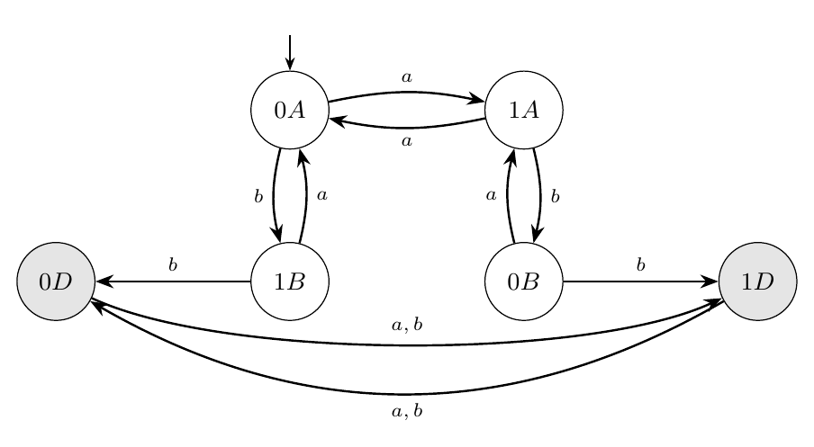

## Abstract

Give a forecaster the exact probability law of a process, then ask what happens next given that the future must obey a declared rule. If it ignores which futures the rule still allows, it can be forced to be wrong by nearly as much as any forecaster can be: error approaching $1-1/d$ on a $d$-symbol alphabet. A model can predict the next word perfectly and still write code that will not compile. Knowing what is likely is not knowing what is allowed, and I make that distinction exact. A history carries two states: its predictive state $\varepsilon$, which fixes its future law, and its residual state $\kappa$, which fixes which continuations a separately declared rule still admits. Each is classical on its own. I prove that the pair $J=(\varepsilon,\kappa)$ is exactly the state of survival-aware prediction. Every survival probability and every survival-conditioned forecast depends only on $J$. Conversely, under full support those forecasts recover $J$ after the finite horizon $\max(k-2,\,m-1)$, and no shorter horizon works in general. The converse survives noise. Forecasts that agree within an explicit margin pin down the residual state exactly and the predictive state to within a bound set by an observability constant, and I give counterexamples showing that neither constant can be dropped. The same state gives value bounds for planning, tight bounds on certificate bases for search by elimination, and a sharp map of when the canonical machine is canonical. The core theorems are machine-checked in Lean 4 (159 theorems, standard axioms only), and every finite claim is reproduced in exact arithmetic.

---

# 1. Introduction

A model can predict the next word perfectly and still write code that will not compile. Knowing what is likely is not knowing what is allowed. Unlikely is not the same as impossible. A weather model that gives a storm a one percent chance has said something about probability. A flight controller that knows a wing cannot survive a particular maneuver has said something about admissibility. Both statements are about the future, both are computed from the past, and it is tempting to treat the second as the limiting case of the first. It is not, and the difference matters most exactly when a mistake cannot be undone.

This is not a philosophical point. Any system that samples from a learned model under hard constraints has to carry both kinds of state, whether it is a code generator that must compile, a planner that must stay feasible, or an agent that must stay inside a safety envelope. Constrained decoders compute the probability that a constraint will still be met, and shields run a policy in lockstep with an automaton. This paper asks what the smallest correct state is for forecasting together with survival reporting, and answers it exactly.

I study histories $h\in\Sigma^*$ over a finite alphabet. A process $p$ assigns probabilities to continuations, and the *predictive state* $\varepsilon(h)$ is the equivalence class of $h$ under equality of its conditional future law. This is the causal state of computational mechanics [58]. An *admissibility rule* $V:\Sigma^*\to\{0,1\}$ declares which histories are still alive, and the *residual state* $\kappa(h)$ is the class of $h$ under equality of $R_V(h)=\{z:V(hz)=1\}$. This is the Myhill–Nerode state of the rule [48, 49]. I keep the rule separate from the process and ask which reporting and decision tasks require their common refinement.

## Where this sits

This is a contribution to computational mechanics. Computational mechanics groups pasts by what they make probable. Its states are causal states, and its canonical machine is the $\varepsilon$-machine [58]. The residual state groups pasts by what a declared rule still allows. That object is not new, and I credit it in full. It is the Myhill–Nerode congruence of the rule [48, 49]. Its classes are the residual languages of automata theory [14, 24]. When the rule lists the allowed words of a shift space, it is the follower-set equivalence of symbolic dynamics, whose graph on infinite pasts is the Krieger cover [37, 40], and the history $\varepsilon$-machine is its probabilistic analogue [64]. For stateful validators it is the coarsest sound abstraction [60].

I pair the predictive state of a process with the residual state of a separately declared rule. The pair is the reachable product of two deterministic state maps. I study what this product determines, which reports recover it, and how much information is lost when one coordinate is removed. I call the canonical machine of the residual state the $\kappa$-machine, by analogy with the $\varepsilon$-machine; it is the minimal automaton of the rule.

## What the pair does

The first result is that the two coordinates are independent (Theorem 4.1). Neither partition refines the other, and for a two-state process together with a three-class admissibility rule, all $2\times 3$ combinations of predictive and residual state occur.

The second result identifies the joint state $J=(\varepsilon,\kappa)$ with a specific reporting task (Section 5). Survival probabilities and survival-conditioned forecasts depend only on $J$, by the product construction familiar from probabilistic model checking [19, 7] and constrained decoding [67, 68]. Under full support, the ordinary forecast together with those survival reports determines $J$ (Theorem 5.4). The horizon $\max(k-2,m-1)$ suffices by the classical Moore and Paz bounds [46, 54], and Proposition 5.10 proves that it cannot be reduced using only $k$ and $m$. Survival reports alone can require less state, even when survival is possible at every finite horizon (Proposition 5.12). Without full support, the combined reports identify the residual only on supported futures (Corollary 5.6). Dropping either coordinate can force next-symbol error close to $1/2$ on a binary alphabet (Proposition 5.7); the sharp ceiling on a $d$-symbol alphabet is $1-1/d$ (Proposition 5.11). The scalar survival-probability ceiling remains $1/2$.

## Four questions

The paper then answers four questions.

**Q1.** *When is the joint state enough to act?* Exactly when the objective factors through it, and in that case single-step choices and multi-step values are determined by $J$ with no extra hypothesis (Proposition 6.1). The deterministic update of $\varepsilon$ that multi-step results use is the classical unifilarity of causal states (Lemma 2.11).

**Q2.** *How large can a certificate basis be?* An elimination search that stores minimal certified impossibilities (nogoods) can need exponentially many of them, by Sperner's theorem. When admissible configurations have at most $r$ elements it needs at most $\binom{n}{\min(r+1,\lfloor n/2\rfloor)}$, which is polynomial for fixed $r$; both bounds are attained, the second for every $r$ (Section 7).

**Q3.** *What happens when residual states are only approximately equal?* Value differences are controlled by the depth at which two residuals first disagree, geometrically in the discount factor, with matching lower-bound examples, in both a planning and a stochastic setting (Propositions 6.3 and 6.4).

**Q4.** *Is the canonical machine really canonical?* In the deterministic category, yes, for every output type, continuous or not (Theorem 3.2). Outside it, no. Nondeterministic presentations of an admissibility rule lose uniqueness already at the minimum size, and they can be exponentially smaller than the canonical machine: for an explicit family the minimum is $n+1$ states against $2^{n-1}+1$ (Theorem 8.6). A process can have a continuum of minimal hidden-state presentations while its canonical machine is infinite (Proposition 8.7).

## What is new and what is not

The table identifies the classical ingredients and the statements I prove from them. A proof of a formulation does not by itself establish publication priority. I use that distinction throughout.

| Result | Kind | Credit |
|---|---|---|
| Residual state, its right congruence, coarsest-statistic property, dead class (Lemmas 2.2, 2.3, 2.5) | classical | Myhill–Nerode [48, 49]; residual languages [14, 24] |
| Finite tests separate residual states (Proposition 2.7) | classical | Moore [46] |
| Predictive state as a right congruence with deterministic update (Lemma 2.11) | classical | causal states [58]; history and generator $\varepsilon$-machines [64] |
| Short continuations separate predictive states (Lemma 2.12) | classical | Paz [54] |
| Excluded continuations (Section 2.5) | reformulation | complements of residual sets; forbidden words of symbolic dynamics [40, 10] |
| Canonical presentation for any output type (Theorem 3.2, Corollary 3.3) | assembled from classical parts | Moore [46]; Myhill–Nerode; the realization literature [31, 4, 17] |
| Independence of $\varepsilon$ and $\kappa$, with all six combinations (Theorem 4.1), and the index sandwich (Proposition 4.2) | explicit instance of classical constructions | reachable products and common refinements; Moore [46], Myhill–Nerode [48, 49] |
| Sufficiency: survival probabilities and conditioned forecasts depend only on $J$ (Proposition 5.3) | classical construction | product of a chain and an automaton [19, 7]; at one step, the Doob transform of a next-symbol law [1, Thm 5] |
| Exactness under full support (Theorem 5.4, Corollary 5.6) | support identification assembled with classical finite tests | recover $V$ from $P_hV$ on supported words; Moore and Paz bounds [46, 54] |
| When masking a next-symbol law is exact | known special case | [1, Thm 6], [50, Prop. 5] |
| Separation for a one-coordinate forecaster (Propositions 5.7 and 5.11) | elementary minimax geometry, realized by explicit process–rule families | triangle inequality, midpoint, and simplex radius |
| Decisions factor through $J$ (Proposition 6.1) | classical in substance | product-state shields [2, 34] |
| Lookahead bound (Proposition 6.2) | new in this form | elementary |
| Value bounds by residual detection depth, with tight families (Propositions 6.3, 6.4) | residual-language formulation of classical discounted comparison | geometric tails; bisimulation metrics and discounting [26, 22] |
| Certificate bases: exponential worst case and the rank bound, both attained (Section 7) | classical inequalities, applied here with tight families | Sperner and LYM [62, 41]; trace and shattering [57, 59] |
| Non-canonicity at the minimum, exponential succinctness (Section 8.1) | classical phenomenon, explicit family here | fooling sets and the subset construction [30, 12, 45] |
| Continuum of minimal hidden-state presentations (Proposition 8.7) | instance of a known phenomenon | hidden Markov realization [33, 3, 65] |
| Support interface with Recursive Asymmetric Duality (Theorem 9.2, Proposition 9.3) | explicit support calculation | discrete Feynman–Kac weights |
| Sharp joint horizon (Proposition 5.10) | explicit full-support witnesses with prescribed actual parameters | matches the Moore and Paz bounds [46, 54] |
| State for survival reports alone (Proposition 5.12) | killed-series quotient and strict example | weighted future languages [16, 28] |
| Quantitative converse and obstructions (Theorem 5.13, Example 5.14) | proved here with explicit conditioning constants | short-test observability [54] and finite-rank realizations [16, 28] |
| Model-dependent genericity (Proposition 4.4, Theorem 4.5) | graph criterion and positive HMM construction proved here | finite products and polynomial exceptional sets |
| Conditioned laws and probabilistic RAD observations (Proposition 9.4, Proposition 9.5, Theorem 9.6, Proposition 9.7) | classical conditioning with explicit observation and response calculations | quasi-stationary laws and $Q$-processes [21, 18] |
| Neutral persistence and commutator limits (Remark 9.8) | explicit counterexamples | orthogonal maps and determinant identities |

The elementary ingredients are classical. Theorem 4.1 realizes a full reachable product; Proposition 4.2 is the common-refinement inequality; Theorem 5.4 recovers the rule on the support and applies the Moore and Paz bounds; Proposition 5.7 uses the midpoint lower bound for two indistinguishable targets. I give the joint reporting formulation, the sharp families of Proposition 5.10, the alphabet-dependent constructions of Proposition 5.11, and the quantitative statement and obstructions of Theorem 5.13 and Example 5.14. I do not claim a new product construction, a new minimax principle, or priority for this whole formulation. Each result is proved here. Appendix A separates the Lean formalization from the results proved only in the text and from finite exact-arithmetic checks.

## Where this comes from

The motivation is search by elimination. Instead of asking what a solution is, ask what it cannot be. One certified impossibility can remove every candidate that shares the disqualifying structure, so a small number of local refutations can collapse a combinatorially large space. That discipline needs a state that tracks what remains possible, kept separate from the state that tracks what is likely, and it needs to know when the two must be combined.

## The linked code submission

FATE, my ARC Prize 2026 code submission for the ARC-AGI-2 track (Kaggle notebook `netphantom17/fate-ssm-final`, submission 57913192), was built and documented under this theory's working name, *Survival State Mechanics* (SSM). It does not test the theorems of this paper. Its candidate answers come from a public open-weights pipeline that is not mine. My part is the selection layer: the model's likelihood may only order candidates, and only an admissibility rule mined from the demonstrations may demote them. That is the division between likely and allowed that this paper makes exact. The submission's score belongs to the pipeline and the layer together, and I claim nothing about it here. The notebook's terms translate as follows.

| Notebook | This paper |
|---|---|
| Survival State Mechanics (SSM) | the joint state of prediction and admissibility |
| survival state $\kappa$ | residual state $\kappa$ (Definition 2.4) |
| survival semantics; the demonstration ledger (shape, palette, count invariants) | admissibility rule $V$ |
| model score, candidate likelihood | predictive state $\varepsilon$ and its forecast (Definition 2.10) |
| SSM mask (variant V1): demote ledger-inadmissible candidates | ordering by $\varepsilon$, demotion by $V$ |
| FATE-certified program (variant V2) | certified admissible, status $\mathrm A$ (Definition 2.17) |
| nogood, certified elimination | certified exclusion, status $\mathrm X$ (Definition 2.17) |

## Organization

Section 2 defines the two states and their common refinement. Section 3 proves deterministic canonicity. Section 4 gives independence and model-dependent genericity. Section 5 treats exact and quantitative reporting, sharp horizons, and minimax separation. Section 6 treats values and decisions. Section 7 bounds certificate bases. Section 8 compares nondeterministic and hidden-state presentations. Section 9 gives the support interface with RAD, separates conditioned laws, and declares probabilistic observations and their limits. Section 10 discusses related work and scope. Appendix A states the verification coverage.

# 2. Histories, residuals, and the two states

Throughout, $\Sigma$ is a finite nonempty alphabet, $\Sigma^*$ the set of finite words, $\Lambda$ the empty word, and $hz$ concatenation. I write $\Sigma^n$ and $\Sigma^{\le n}$ for words of length exactly $n$ and at most $n$, and $\Sigma^{\mathbb{N}}$ for infinite sequences $z=z_1z_2\cdots$, with prefixes $z_{\le t}$ and $z_{<t}=z_{\le t-1}$. A *history* is an element of $\Sigma^*$.

## 2.1 Residual congruences

Everything in this paper is built from one construction.

**Definition 2.1** (Semantics and residuals). A *semantics* is any map $F:\Sigma^*\to X$ into an arbitrary set $X$. The *residual* of a history $h$ is $F_h:\Sigma^*\to X$, $F_h(z)=F(hz)$. Two histories are *$F$-equivalent*, $h\sim_F h'$, if $F_h=F_{h'}$. The *index* $\operatorname{ind}(F)$ is the number of equivalence classes.

**Lemma 2.2**. $\sim_F$ is an equivalence relation and a right congruence: $h\sim_F h'$ implies $hz\sim_F h'z$ for every $z\in\Sigma^*$.

*Proof.* It is equality of functions, so it is an equivalence. If $F_h=F_{h'}$ then $F_{hz}(y)=F(hzy)=F_h(zy)=F_{h'}(zy)=F_{h'z}(y)$ for every $y$. ◻

**Lemma 2.3** (Coarsest residual statistic). For a map $s:\Sigma^*\to S$ the following are equivalent: (i) there is $g$ with $F_h=g(s(h))$ for all $h$; (ii) $s(h)=s(h')$ implies $h\sim_F h'$. In particular the class map $h\mapsto[h]_F$ is the coarsest statistic from which residuals can be read.

*Proof.* (i)$\Rightarrow$(ii) is immediate. For (ii)$\Rightarrow$(i), define $g(s(h)):=F_h$; (ii) makes this well defined on the image of $s$, and $g$ is arbitrary off it. ◻

## 2.2 The residual state

**Definition 2.4** (Admissibility rule and residual state). An *admissibility rule* is a map $V:\Sigma^*\to\{0,1\}$; $V(h)=1$ means $h$ is alive. The *residual admissibility set* of $h$ is $$R_V(h)=\{\,z\in\Sigma^* : V(hz)=1\,\},$$ which is the residual $V_h$ written as a set. The *residual state* $\kappa(h)$ is the class of $h$ under $\sim_{\kappa}\;:=\;\sim_V$. The semantics is *monotone* if $V(hz)=1$ implies $V(h)=1$: death is absorbing.

Monotonicity is what the word "survival" means, and it is assumed in Section 5 and in Propositions 6.3 and 6.4. The structural results of Sections 3, 4 and 8 hold for arbitrary $V$, which is useful when $V$ encodes an admissibility condition that a history can leave and re-enter. For monotone $V$, $R_V(h)$ is prefix-closed and is exactly the set of continuations that keep $h$ alive at every step.

**Lemma 2.5** (The dead class). The histories with $R_V(h)=\varnothing$ form a single $\sim_{\kappa}$-class whenever there is at least one, and this class is absorbing: $R_V(h)=\varnothing$ implies $R_V(hz)=\varnothing$. If $V$ is monotone, $R_V(h)=\varnothing$ if and only if $V(h)=0$.

*Proof.* All such histories share the residual $\varnothing$. Absorption: $R_V(hz)=\{y: zy\in R_V(h)\}$. For monotone $V$, if $V(h)=0$ then $V(hz)=0$ for all $z$, so $R_V(h)=\varnothing$; conversely $\Lambda\notin R_V(h)$ means $V(h)=0$. ◻

Real systems often expose different legal moves at different histories. Nothing is lost by totalizing.

**Proposition 2.6** (Partial histories). Let $H\subseteq\Sigma^*$ be prefix-closed and $V_H:H\to\{0,1\}$. Put $\bar V(w)=V_H(w)$ for $w\in H$ and $\bar V(w)=0$ otherwise. Then (a) for $h\in H$, $R_{\bar V}(h)=\{z: hz\in H,\ V_H(hz)=1\}$; (b) for $h\notin H$, $R_{\bar V}(h)=\varnothing$; (c) if $V_H$ is monotone on $H$ then $\bar V$ is monotone.

*Proof.* (a) is the definition of $\bar V$. (b) If $hz\in H$ then $h\in H$ by prefix-closure, so $h\notin H$ forces $\bar V(hz)=0$ for all $z$. (c) If $\bar V(hz)=1$ then $hz\in H$, hence $h\in H$, and $V_H(h)=1$ by monotonicity on $H$. ◻

So nothing is lost by working with semantics defined on all of $\Sigma^*$: illegal moves become moves into the dead class, and every legal history keeps exactly the residual it had. I do this from now on.

Residual sets are infinite, but finitely many tests always suffice when the index is finite. For $Z\subseteq\Sigma^*$ write $h\sim^Z h'$ if $V(hz)=V(h'z)$ for all $z\in Z$.

**Proposition 2.7** (Finite tests). (a) If $Z\subseteq Z'$ then $\sim^{Z'}\subseteq\sim^{Z}$, and $\sim_{\kappa}\;=\;\sim^{\Sigma^*}$. (b) If $2\le\operatorname{ind}(V)=k<\infty$ then $\sim_{\kappa}\;=\;\sim^{\Sigma^{\le k-2}}$.

*Proof.* (a) is immediate. For (b) write $\approx_j$ for $\sim^{\Sigma^{\le j}}$. Each $\approx_j$ is coarser than $\sim_{\kappa}$, so it has at most $k$ classes. Since $\Sigma^{\le j+1}=\{\Lambda\}\cup\bigcup_{e}e\,\Sigma^{\le j}$, we have $h\approx_{j+1}h'$ iff $V(h)=V(h')$ and $he\approx_j h'e$ for every $e$. Hence if $\approx_{j+1}\,=\,\approx_j$ then $\approx_{j+2}\,=\,\approx_{j+1}$, the chain is constant from $j$ on, and $\approx_j\,=\bigcap_i\approx_i\,=\,\sim_{\kappa}$. Since $k\ge2$, $V$ is not constant, so $\approx_0$ has exactly two classes. Every strict refinement adds a class, so at most $k-2$ strict refinements occur and $\approx_{k-2}$ is already stable. ◻

This is the $k-2$ bound on Moore's equivalences for a $k$-state automaton [11], stated here for histories; cf. [46] for the original distinguishing experiments. It is tight even for monotone $V$: take $V(w)=1$ iff $|w|\le k-2$.

**Example 2.8** (Running example). Let $\Sigma=\{a,b\}$ and let $V_{\mathsf{bb}}(w)=1$ iff $w$ contains no factor $\mathsf{bb}$. This is monotone, and $\kappa$ has three classes: $A$ (alive, not ending in $b$, including $\Lambda$), $B$ (alive, ending in $b$), and $D$ (dead). The test $b$ separates $A$ from $B$, and $\Lambda$ separates both from $D$.

## 2.3 The predictive state

**Definition 2.9** (Process). A *process* is a map $p:\Sigma^*\to[0,1]$ with $p(\Lambda)=1$ and $p(w)=\sum_{a\in\Sigma}p(wa)$ for all $w$. Its support is $\operatorname{Supp}(p)=\{w:p(w)>0\}$. It has *dimension at most $m$* if there are a row vector $\iota\in\mathbb{R}^{1\times m}$, matrices $T^{x}\in\mathbb{R}^{m\times m}$ ($x\in\Sigma$), and a column vector $\theta\in\mathbb{R}^{m\times1}$ with $p(x_1\cdots x_n)=\iota\, T^{x_1}\cdots T^{x_n}\theta$ for all words.

A process is the same thing as a probability measure on $\Sigma^{\mathbb{N}}$, by Carathéodory's extension theorem. Every hidden Markov model with $m$ hidden states gives a process of dimension at most $m$, and the least such $m$ is the rank of the Hankel matrix $(p(uv))_{u,v}$ [28, 16]. Since $p(w)=\sum_a p(wa)$ with nonnegative terms, $p(wz)\le p(w)$.

**Definition 2.10** (Predictive state). For $h\in\operatorname{Supp}(p)$ let $P_h(z)=p(hz)/p(h)$, the conditional law of the continuation. Two histories are *predictively equivalent*, $h\sim_{\varepsilon}h'$, if either both are null ($p(h)=p(h')=0$) or both lie in the support and $P_h=P_{h'}$. The *predictive state* $\varepsilon(h)$ is the class of $h$.

On the support these are the causal states of the process started at time zero [58]. The null histories are collected into a single class $\bot$, so when $\operatorname{Supp}(p)\neq\Sigma^*$ the index of $\varepsilon$ is one more than the number of causal states.

**Lemma 2.11** (The predictive state is a residual congruence). $\sim_{\varepsilon}$ is a right congruence, and $P_h$ is determined by $\varepsilon(h)$ on the support. Moreover $\sim_{\varepsilon}\;=\;\sim_\Phi$ for the semantics $\Phi(w)=P_w$ if $w\in\operatorname{Supp}(p)$ and $\Phi(w)=\bot$ otherwise.

This is the unifilarity of causal states [58]; I include the short proof because the null class needs care.

*Proof.* Let $h\sim_{\varepsilon}h'$ and $e\in\Sigma$. If both are null, so are $he$ and $h'e$, since $p(he)\le p(h)$. Otherwise $P_h(e)=P_{h'}(e)$. If this common value is $0$, both $he,h'e$ are null. If not, both lie in the support and $$P_{he}(z)=\frac{P_h(ez)}{P_h(e)}=\frac{P_{h'}(ez)}{P_{h'}(e)}=P_{h'e}(z).$$ For the last claim: if $h\sim_{\varepsilon}h'$ then by the first part $hz\sim_{\varepsilon}h'z$ for every $z$, so $\Phi(hz)=\Phi(h'z)$ and $\Phi_h=\Phi_{h'}$. Conversely $\Phi_h=\Phi_{h'}$ gives $\Phi(h)=\Phi(h')$ at $z=\Lambda$, which is $h\sim_{\varepsilon}h'$. ◻

For finite-dimensional processes, predictive states are separated by short continuations. This is the probabilistic counterpart of Proposition 2.7(b) and is due, in the automaton setting, to Paz [54].

**Lemma 2.12** (Short continuations suffice). If $p$ has dimension at most $m$ and $h,h'\in\operatorname{Supp}(p)$, then $P_h=P_{h'}$ if and only if $P_h(z)=P_{h'}(z)$ for all $|z|\le m-1$.

*Proof.* Write $u_h=\iota T^{h}/p(h)$, so that $P_h(z)=u_hT^{z}\theta$. Let $W_j=\operatorname{span}\{T^{z}\theta: |z|\le j\}$. Then $W_{j+1}=W_0+\sum_x T^xW_j$, so $W_{j+1}=W_j$ implies $W_{j'}=W_j$ for all $j'\ge j$. Since $\dim W_0\le 1$ and each strict inclusion raises the dimension, $W_{m-1}=W_\infty$. ($\theta\ne0$ because $\iota\theta=p(\Lambda)=1$.) Hence $u_h-u_{h'}$ annihilates $W_\infty$ as soon as it annihilates $W_{m-1}$. ◻

## 2.4 The joint state

**Definition 2.13** (Joint state). $J(h)=(\varepsilon(h),\kappa(h))$, with $h\sim_{J}h'$ iff $h\sim_{\varepsilon}h'$ and $h\sim_{\kappa}h'$.

By Lemma 2.11, $\sim_{J}$ is the residual congruence of the paired semantics $w\mapsto(\Phi(w),V(w))$, and in particular it is a right congruence. Every construction of Section 3 therefore applies to $\varepsilon$, to $\kappa$, and to $J$ alike.

## 2.5 Excluded continuations

The residual state is defined through what remains admissible. The same object can be read through what has been excluded.

**Definition 2.14** (Excluded continuations). Let $V:\Sigma^*\to\{0,1\}$ be an admissibility rule. The *excluded continuations* of a history $h$ are
$$\overline R_V(h)=\{\,z\in\Sigma^*: V(hz)=0\,\}=\Sigma^*\setminus R_V(h).$$

**Proposition 2.15** (Exclusion carries the residual state).

(a) $h\sim_{\kappa}h'$ if and only if $\overline R_V(h)=\overline R_V(h')$.

(b) $\overline R_V(hz)=\{\,y\in\Sigma^*: zy\in\overline R_V(h)\,\}$ for all $h,z$.

(c) If $V$ is monotone, then $z\in\overline R_V(h)$ implies $zy\in\overline R_V(h)$ for every $y\in\Sigma^*$: an excluded continuation stays excluded under every extension.

(d) If $V$ is monotone, the dead class of Lemma 2.5 is the class of histories with $\overline R_V(h)=\Sigma^*$.

*Proof.* (a) $\overline R_V(h)$ is the complement of $R_V(h)$, and $h\sim_{\kappa}h'$ means $R_V(h)=R_V(h')$. (b) $y\in\overline R_V(hz)$ iff $V(hzy)=0$ iff $zy\in\overline R_V(h)$. (c) Monotonicity gives $V(hzy)=1\Rightarrow V(hz)=1$; take the contrapositive. (d) $R_V(h)=\varnothing$ iff $\overline R_V(h)=\Sigma^*$, and Lemma 2.5 identifies these histories with the dead class. ◻

**Remark 2.16** (Symbolic dynamics). Let $X$ be a shift space with language $\mathcal L(X)$ and take $V=\mathbf 1_{\mathcal L(X)}$. Then $R_V(h)$ is the follower set of $h$ in $X$, so the residual states of this rule are the follower-set classes of words [40]. On infinite pasts the follower-set classes form the Krieger cover, which is finite exactly when $X$ is sofic [37, 64]. The excluded continuations of $h$ are the $z$ for which $hz$ is forbidden in $X$. A language of a shift is closed under prefixes, so such a rule is monotone. The rules of this paper are more general: they need not be closed under subwords or extendable, and the structural results of Sections 3, 4, and 8 do not assume monotonicity.

**Definition 2.17** (Certified exclusion). An elimination procedure reports for a pair $(h,z)$ one of three statuses: $\mathrm A$ (certified admissible), $\mathrm X$ (certified excluded), or $\mathrm U$ (unresolved). It is *sound* if $\mathrm A$ implies $z\in R_V(h)$ and $\mathrm X$ implies $z\in\overline R_V(h)$.

The rule is two-valued; $\mathrm U$ reports the state of knowledge, not a third truth value. Under a sound procedure the certified-excluded continuations of $h$ form a subset of $\overline R_V(h)$, and for monotone $V$ a sound $\mathrm X$ at $z$ licenses $\mathrm X$ at every extension $zy$ by Proposition 2.15(c). Section 7 bounds how many minimal certified exclusions such a procedure must store. Minimal non-members of a down-closed family are the set-theoretic counterpart of the minimal forbidden words of symbolic dynamics [10].

# 3. Canonical machines

A state is only useful if it can be updated one symbol at a time. Right congruence gives exactly that, and it gives a machine that every other exact machine collapses onto.

**Definition 3.1** (Deterministic presentation). A *deterministic presentation* of a semantics $F:\Sigma^*\to X$ is a tuple $P=(S,s_0,\delta,\ell)$ with a state set $S$, a start state $s_0$, a transition map $\delta:S\times\Sigma\to S$ extended to words by $\delta^*$, and an output map $\ell:S\to X$, such that $\ell(\delta^*(s_0,w))=F(w)$ for every $w$. It is *reachable* if every state equals $\delta^*(s_0,w)$ for some $w$. A *morphism* $\psi:P\to P'$ is a map $S\to S'$ with $\psi(s_0)=s_0'$, $\psi(\delta(s,a))=\delta'(\psi(s),a)$, and $\ell'(\psi(s))=\ell(s)$. The *residual presentation* is $$P_F=\left(\Sigma^*/\!\sim_F,\ [\Lambda],\ ([h],a)\mapsto[ha],\ [h]\mapsto F(h)\right),$$ which is well defined by Lemma 2.2.

**Theorem 3.2** (Canonical presentation, any output type). Let $F:\Sigma^*\to X$ be any semantics.

(a) $P_F$ is a reachable deterministic presentation of $F$.

(b) Every reachable presentation $P$ of $F$ admits exactly one morphism $P\to P_F$, and it is surjective.

(c) For a reachable presentation $P$ the unique morphism $P\to P_F$ is bijective if and only if $\delta^*(s_0,w)=\delta^*(s_0,w')\iff w\sim_F w'$ for all $w,w'$. A bijective morphism has a morphism as its inverse, so such a $P$ is isomorphic to $P_F$, by a unique isomorphism.

(d) If $S$ is finite, the morphism $P\to P_F$ is bijective if and only if $|S|=\operatorname{ind}(F)$. In particular $\operatorname{ind}(F)\le|S|$ for every reachable presentation, and all presentations attaining this minimum are isomorphic.

*Proof.* (a) $\delta_F^*([\Lambda],w)=[w]$ by induction on $w$, and $\ell_F([w])=F(w)$.

(b) Define $\psi(\delta^*(s_0,w))=[w]$. This is well defined: if $\delta^*(s_0,w)=\delta^*(s_0,w')$ then for every $z$, $F(wz)=\ell(\delta^*(\delta^*(s_0,w),z))=\ell(\delta^*(\delta^*(s_0,w'),z))=F(w'z)$, so $w\sim_F w'$. It is defined everywhere because $P$ is reachable, and it is a morphism by construction. Any morphism $\psi'$ satisfies $\psi'(\delta^*(s_0,w))=\delta_F^*([\Lambda],w)=[w]$ by induction on $w$, so $\psi'=\psi$. Surjectivity: $[w]=\psi(\delta^*(s_0,w))$.

(c) Given (b), $\psi$ is injective iff $w\sim_F w'$ forces $\delta^*(s_0,w)=\delta^*(s_0,w')$; the other implication always holds. If $\psi$ is bijective, its inverse $\phi$ satisfies $\phi([\Lambda])=s_0$, $\phi([w]a)=\phi([wa])=\delta^*(s_0,wa)=\delta(\phi([w]),a)$, and $\ell(\phi([w]))=F(w)=\ell_F([w])$, so it is a morphism. Uniqueness of the isomorphism follows from uniqueness of morphisms out of a reachable presentation.

(d) A surjection between finite sets is a bijection exactly when the sets have the same size. ◻

Nothing in the proof uses any structure on $X$. The theorem is the minimal realization theorem for machines with outputs, which goes back to Moore [46] and has the categorical form "minimal realization is universal" [31, 4, 17]. I state it in this generality because it shows that canonicity holds for every output type, continuous or not, as long as the machine is deterministic.

**Corollary 3.3** (Three canonical machines). The $\kappa$-machine $P_V$, the predictive machine $P_\Phi$, and the joint machine $P_{(\Phi,V)}$ are each the unique minimal reachable deterministic presentation of their semantics. The joint machine is the reachable part of the product of the other two, and its index is the number of reachable pairs.

*Proof.* The first sentence is Theorem 3.2. The reachable part of the product $P_\Phi\times P_V$ sends $w$ to $([w]_\Phi,[w]_V)$, whose kernel is $\sim_{\varepsilon}\cap\sim_{\kappa}\;=\;\sim_{J}$; apply Theorem 3.2(c). ◻

$P_\Phi$ is the $\varepsilon$-machine of the process, with one extra absorbing state for the null histories when there are any [58]. $P_V$ is the minimal automaton of the survival language. For the running example, $P_V$ has the three states $A,B,D$ of Example 2.8.

# 4. Prediction and admissibility are independent

I use independence here to mean that neither history partition refines the other. This is a statement about two state maps. It does not assert probabilistic independence of random variables, since I have specified no probability distribution on the set of finite histories. The construction below realizes every pair in a product of size two by three. Proposition 4.2 is the corresponding elementary common-refinement bound.

**Theorem 4.1** (Independence). Let $\Sigma=\{a,b\}$, $V=V_{\mathsf{bb}}$, and let $p_{\alpha,\beta}$ emit independent symbols with $\Pr(a)=\alpha$ at even positions and $\Pr(a)=\beta$ at odd positions (positions counted from $0$), where $\alpha\ne\beta$ lie in $(0,1)$. Then:

(a) $\varepsilon(h)$ is determined by $|h|\bmod 2$, and $\varepsilon$ has exactly two classes;

(b) $\kappa$ has exactly the three classes $A,B,D$;

(c) $J$ has exactly six classes, represented by $\Lambda,\,a,\,b,\,ab,\,\mathsf{bb},\,a\mathsf{bb}$;

(d) $\Lambda\sim_{\kappa}a$ but $\Lambda\not\sim_{\varepsilon}a$, while $a\sim_{\varepsilon}b$ but $a\not\sim_{\kappa}b$. Neither partition refines the other.

*Proof.* Every word has positive probability. For a continuation $z$ of length $n$, $$P_h(z)=\prod_{i=0}^{n-1} q_{|h|+i}(z_{i+1}),\qquad q_t(a)=\begin{cases}\alpha& t\text{ even},\\ \beta & t\text{ odd}.\end{cases}$$ This depends on $h$ only through $|h|\bmod 2$, and the two parities give $P_h(a)=\alpha\ne\beta$, which proves (a). Part (b) is Example 2.8. For (c), the six listed histories realize the pairs (even, $A$), (odd, $A$), (odd, $B$), (even, $B$), (even, $D$), (odd, $D$), which are all $2\times3$ combinations, so $J$ has exactly six classes. Part (d) reads off (a) and (b). ◻

**Figure 1.** The joint machine of Theorem 4.1. The digit is $\varepsilon$ (parity of the length), the letter is $\kappa$. Forecasting uses the digit, survival uses the letter, and survival-conditioned forecasting (Section 5) needs both.

Figure 1 draws the six-state joint machine. The states $0A$ and $1A$ share a residual state and differ in prediction; the states $0A$ and $0B$ share a predictive state and differ in survival. In general the index of the joint state is squeezed as follows.

**Proposition 4.2** (Index sandwich). $\max(\operatorname{ind}\varepsilon,\operatorname{ind}\kappa)\le\operatorname{ind}J\le\operatorname{ind}\varepsilon\cdot\operatorname{ind}\kappa$. If $\operatorname{ind}J<\infty$, then $\operatorname{ind}J=\operatorname{ind}\kappa$ exactly when $\sim_{\kappa}\subseteq\sim_{\varepsilon}$, and $\operatorname{ind}J=\operatorname{ind}\varepsilon$ exactly when $\sim_{\varepsilon}\subseteq\sim_{\kappa}$. Consequently, when $\operatorname{ind}J<\infty$, $\varepsilon$ and $\kappa$ are incomparable if and only if $\operatorname{ind}J>\max(\operatorname{ind}\varepsilon,\operatorname{ind}\kappa)$.

*Proof.* $\sim_{J}$ refines both, which gives the lower bound, and $[h]_J\mapsto(\varepsilon(h),\kappa(h))$ is injective, which gives the upper bound. If $\sim_{\kappa}\subseteq\sim_{\varepsilon}$ then $\sim_{J}\;=\;\sim_{\kappa}$. Conversely, $\sim_{J}\subseteq\sim_{\kappa}$, and a refinement with the same finite number of classes is an equality, so $\operatorname{ind}J=\operatorname{ind}\kappa$ forces $\sim_{J}\;=\;\sim_{\kappa}$ and hence $\sim_{\kappa}\subseteq\sim_{\varepsilon}$. The other case is symmetric. ◻

**Corollary 4.3**. If $\varepsilon(h)$ and $\kappa(h)$ can both be read from a statistic $s(h)$, then $s(h)=s(h')$ implies $J(h)=J(h')$.

In the running example the upper bound is attained. It is also easy to land at the lower bound: if $p$ is i.i.d. with full support, $\varepsilon$ is trivial and $J=\kappa$; if $V$ is the parity of the length and $p=p_{\alpha,\beta}$, then $\varepsilon=\kappa$. Receipt R1 checks the sandwich and its equality cases across five processes and five rules.

**Proposition 4.4** (Generic weights on a fixed unifilar graph). Fix a reachable finite deterministic transition system $(E,e_0,\delta_E)$, a minimal reachable rule machine $(K,k_0,\delta_K,V)$, and an alphabet of at least two symbols. Give each $e\in E$ a strictly positive emission vector. Draw the vectors jointly from a distribution absolutely continuous on the product of the open probability simplices. Let
$$\mathcal R=\{(\delta_E^*(e_0,h),\delta_K^*(k_0,h)):h\in\Sigma^*\}.$$
Almost surely the predictive-state map is the $E$-state map, and
$$\varepsilon\text{ and }\kappa\text{ are incomparable}
\quad\Longleftrightarrow\quad |\mathcal R|>\max(|E|,|K|).$$
In particular, full product reachability and $|E|,|K|>1$ imply incomparability almost surely.

*Proof.* For each pair of distinct states, equality of their emission vectors is a positive-codimension linear condition in the product of simplices. It has Lebesgue measure zero. There are finitely many pairs. Outside their union, all state emission vectors are distinct, so next-symbol forecasts distinguish every pair of states. A known start and deterministic symbol updates make the current state a function of history. Equal current states give equal future laws by the same transition and emission rules. Thus the predictive-state map is exactly the state map to $E$. All words have positive probability. The joint classes are therefore exactly the reachable pairs in $\mathcal R$, and Proposition 4.2 gives the equivalence. If the full product is reachable and both factors have more than one state, its size exceeds either factor. ◻

Weights do not change $\mathcal R$. If one state map factors through the other, randomizing positive emissions preserves that comparability almost surely. A random transition-graph model would require a separate reachability analysis.

**Theorem 4.5** (Generic positive HMMs distinguish finite histories). In the open parameter space of binary two-state edge-emitting HMMs with strictly positive entries and a positive initial law, almost every parameter choice satisfies
$$P_h(a)\ne P_{h'}(a)\qquad\text{for every distinct pair }h,h'\in\Sigma^*.$$
The same statement holds when the initial law is chosen to be stationary. Thus $\varepsilon$ has singleton classes on finite histories and refines the partition of every admissibility rule.

*Proof.* I first give one positive stationary example that separates every pair:
$$T^a=\begin{pmatrix}3/8&1/8\\1/8&1/8\end{pmatrix},\qquad
T^b=\begin{pmatrix}1/8&3/8\\1/8&5/8\end{pmatrix},\qquad
\pi=(1/3,2/3).$$
The sum of the matrices is row-stochastic and $\pi(T^a+T^b)=\pi$. If $x$ is the posterior probability of hidden state zero, Bayes' rule gives
$$F_a(x)=\frac{1+2x}{2+2x},\qquad F_b(x)=\frac1{6-2x}.$$
Both maps are strictly increasing on $[0,1]$. Their ranges are $[1/2,3/4]$ and $[1/6,1/4]$, which are disjoint. The initial $x_0=1/3$ lies in neither range. Equal posteriors after two nonempty words therefore force equal last letters. Injectivity cancels that last update. Repeating either cancels the whole words, or leaves an empty word with posterior $x_0$ equal to a nonempty-word posterior in one of the two ranges, which is impossible. Hence different words always give different posteriors. The next-symbol probability is $P(a\mid x)=1/4+x/4$, so it too differs for every distinct pair.

For a fixed pair $h\ne h'$, its forecast difference is a rational function of the independent stochastic parameters, with positive denominators. For example, in each row of $(T^a,T^b)$ choose three entries freely and let the fourth be one minus their sum; the positive domain is open in these six coordinates. Clearing denominators gives a polynomial, also in the one free initial-law coordinate. It is not the zero polynomial because the displayed example makes the difference nonzero. A nonzero real polynomial has a Lebesgue-null zero set: in one variable it has finitely many roots; induction on the number of variables, followed by Fubini's theorem outside the null set on which all coefficient polynomials vanish, proves the general statement. There are countably many finite-word pairs. Their exceptional sets have a null union.

For stationary initialization, the positive stochastic sum $T=T^a+T^b$ has stationary law
$$\pi_0=\frac{T_{10}}{T_{01}+T_{10}},\qquad
\pi_1=\frac{T_{01}}{T_{01}+T_{10}}.$$
These are rational functions with positive denominator. Clear this denominator too. The same stationary example makes every pair's polynomial nonzero, so the preceding null-set argument applies on the six-dimensional matrix parameter domain. Singleton predictive classes refine every partition of the finite histories, proving the last assertion. ◻

This theorem concerns the finite histories of Definition 2.10. It makes no claim about equivalence classes of infinite pasts modulo null sets. A finite hidden-state presentation and a finite number of predictive states are different assumptions. Incomparability is realizable, but it is not generic across all finite-dimensional models.

# 5. Survival-conditioned prediction

Fix a process $p$ and a *monotone* admissibility rule $V$. Monotonicity means that a continuation $z$ keeps $h$ alive at every step exactly when $V(hz)=1$.

**Definition 5.1** (Survival probability and conditioned forecasts). For $h\in\operatorname{Supp}(p)$ and $n\in\mathbb{N}$ let $$S_n(h)=\sum_{z\in\Sigma^n}P_h(z)\,V(hz),\qquad
Q_n(z\mid h)=\frac{P_h(z)\,V(hz)}{S_n(h)}\quad(z\in\Sigma^n,\ S_n(h)>0).$$ $S_n(h)$ is the probability of surviving the next $n$ steps, so $S_0(h)=V(h)$, and $Q_n(\cdot\mid h)$ is the law of the next $n$ symbols given that they are survived. Let $S_\infty(h)=\lim_{n}S_n(h)$ and, when $S_\infty(h)>0$, $$Q_\infty(z\mid h)=\frac{P_h(z)\,S_\infty(hz)}{S_\infty(h)}\qquad(z\in\Sigma^*),$$ with the convention that a term with $P_h(z)=0$ is $0$.

**Lemma 5.2** (Surviving forever). $S_{n+1}(h)\le S_n(h)$, so $S_\infty$ exists. Let $E_\infty$ be the event that the continuation keeps $h$ alive forever. Then for every $j\in\mathbb{N}$ and $z\in\Sigma^j$, $$\Pr\nolimits_h\left(Z_{\le j}=z,\ E_\infty\right)=P_h(z)\,S_\infty(hz).$$ Consequently, when $S_\infty(h)>0$, $Q_\infty(\cdot\mid h)$ restricted to $\Sigma^j$ is the law of the first $j$ symbols conditioned on $E_\infty$, and $(Q_\infty(\cdot\mid h))_j$ is a consistent family defining that conditioned process.

*Proof.* Each survived word of length $n+1$ has a survived prefix of length $n$, and $\sum_eP_h(ye)=P_h(y)$, so $S_{n+1}\le S_n$. Let $E_n$ be the event that the first $n$ symbols are survived. By monotonicity the events $E_n$ decrease to $E_\infty$. For $n\ge j$, $$\Pr\nolimits_h(Z_{\le j}=z,\,E_n)=\sum_{y\in\Sigma^{n-j}}P_h(zy)V(hzy)=P_h(z)\,S_{n-j}(hz),$$ where the case $P_h(z)=0$ is trivially $0$. Letting $n\to\infty$ and using continuity from above gives the formula. Dividing by $\Pr_h(E_\infty)=S_\infty(h)$ gives the conditional law, and summing over the last symbol shows consistency. ◻

This is Doob's $h$-transform [25] of the process by the survival function $S_\infty$; see [39, §17.6] for the Markov-chain version and [18] for conditioning on non-absorption.

**Proposition 5.3** (Sufficiency). For every finite $Z\subseteq\Sigma^*$ and every function $g$, the quantity $\sum_{z\in Z}P_h(z)\,g(R_V(h),z)$ depends on $h\in\operatorname{Supp}(p)$ only through $J(h)$. In particular $S_n(h)$ and $Q_n(\cdot\mid h)$ depend only on $J(h)$ for every $n\in\mathbb{N}\cup\{\infty\}$, and so does any limit $\lim_nQ_n^{(j)}(\cdot\mid h)$ of the first-$j$-symbol marginals when it exists.

*Proof.* $P_h$ is a function of $\varepsilon(h)$ and $R_V(h)$ is a function of $\kappa(h)$. For $n=\infty$: $S_\infty$ is a limit of functions of $J$, and in $Q_\infty(z\mid h)$ the factor $S_\infty(hz)$, when $P_h(z)>0$, depends on $J(hz)$, which is determined by $J(h)$ and $z$ because $\sim_{J}$ is a right congruence. ◻

Sufficiency is the product construction of probabilistic model checking [19, 7], and it is how constrained decoders compute the probability that a constraint will still be met [67, 68]; recent work describes the exact constrained sampler as a Doob transform [1, 50, 69]. I prove a converse for the combined reporting task: the ordinary forecast, survival probabilities, and survival-conditioned forecasts. Under full support, any statistic that determines all these outputs determines $J$. For survival reports alone, the coarsest statistic can be strictly smaller (Proposition 5.12).

For $h\in\operatorname{Supp}(p)$ collect everything a survival-aware forecaster can report, the ordinary forecast together with the survival data: $$\Psi(h)=\left(P_h,\;\left(S_n(h)\right)_{n\ge0},\;\left(Q_n(\cdot\mid h)\right)_{n\ge1}\right),$$ where $Q_n(\cdot\mid h)$ is treated as undefined when $S_n(h)=0$. Let $\Psi_H(h)$ be the same data truncated to horizon $H$: $P_h$ on $\Sigma^{\le H}$, and $S_n,Q_n$ for $n\le H$.

**Theorem 5.4** (Combined reports identify the joint state). Let $h,h'\in\Sigma^*$ be histories all of whose continuations have positive probability ($p(hz)>0$ and $p(h'z)>0$ for all $z$).

(a) $\Psi(h)=\Psi(h')$ if and only if $J(h)=J(h')$.

(b) If $p$ has dimension at most $m$ and $\operatorname{ind}(V)=k$ is finite, then already $\Psi_{H^*}(h)=\Psi_{H^*}(h')$ if and only if $J(h)=J(h')$, where $H^*=\max(k-2,\,m-1)$.

(c) The positivity hypothesis cannot be dropped from (a).

*Proof.* The "if" directions are Proposition 5.3. For "only if" in (a): $P_h=P_{h'}$ gives $h\sim_{\varepsilon}h'$. For $\kappa$, fix $n$. If $S_n(h)=0$ then no $z\in\Sigma^n$ has $V(hz)=1$, since each has $P_h(z)>0$. If $S_n(h)>0$ then, again because $P_h(z)>0$, $V(hz)=1$ exactly when $Q_n(z\mid h)>0$. Either way $R_V(h)\cap\Sigma^n$ is determined by $(S_n(h),Q_n(\cdot\mid h))$, and $n=0$ is covered by $S_0(h)=V(h)$. So $R_V(h)=R_V(h')$.

For (b): agreement of $P_h$ and $P_{h'}$ on $\Sigma^{\le m-1}$ gives $h\sim_{\varepsilon}h'$ by Lemma 2.12. The argument of (a) recovers $R_V(h)\cap\Sigma^{\le k-2}$ from $\Psi_{k-2}(h)$, and Proposition 2.7(b) turns agreement there into $h\sim_{\kappa}h'$ when $k\ge2$; when $k=1$ there is nothing to prove.

For (c): let $p$ emit $a$ forever and let $V(w)=0$ iff $w$ begins with $ab$. The histories $\Lambda$ and $a$ have the same continuation law (all $a$'s), and every continuation that occurs is survived by both, so $\Psi(\Lambda)=\Psi(a)$. But $b\in R_V(\Lambda)$ and $b\notin R_V(a)$, so $\kappa(\Lambda)\ne\kappa(a)$. ◻

The converse is short. What makes it work is the combination of the ordinary forecast with the survival data, and positivity; neither can be dropped. Monotonicity of $V$ is not used in the proof of (a) or (b).

**Remark 5.5** (Both ingredients of $\Psi$ are needed). The survival data $(S_n,Q_n)_n$ alone do not determine $\varepsilon$. Take the Markov chain on $\{a,b\}$ with $\Pr(a\mid a)=3/10$ and $\Pr(a\mid b)=7/10$ (any full-support initial law) and $V(w)=1$ iff $|w|\le1$. For $h=a$ and $h'=b$ the reports satisfy $S_0=1$ and $S_n=0$ for $n\ge1$, so the survival data agree, but $P_a\ne P_b$. Proposition 5.12 gives an example with positive survival at every finite horizon. Proposition 5.10 proves the sharpness of both parts of $H^*$ for prescribed actual dimensions and rule indices.

Part (c) shows that forecasts do not in general identify admissibility off the process support. This is a failure of identification from these reports alone. Structural assumptions can still force an off-support truth value. For example, $S_0(h)=0$ means $V(h)=0$, and monotonicity then gives $V(hz)=0$ for every continuation, including those outside the support.

The blind spot in (c) has an exact description, and it is the only one. For $h\in\operatorname{Supp}(p)$ write $F(h)=\operatorname{Supp}(P_h)=\{z:p(hz)>0\}$ for the futures that the process can visit from $h$, and $$\kappa_p(h)=R_V(h)\cap F(h)$$ for the residual state seen through the visited futures. Since $P_h$ is a function of $\varepsilon(h)$, so is $F(h)$.

**Corollary 5.6** (What the forecasts see without full support). For $h,h'\in\operatorname{Supp}(p)$, $\Psi(h)=\Psi(h')$ if and only if $\varepsilon(h)=\varepsilon(h')$ and $\kappa_p(h)=\kappa_p(h')$. Thus the combined reports recover the admissibility mask on supported futures. They contain no direct off-support mask coordinates; further conclusions there require structural assumptions. When $F(h)=\Sigma^*$, they determine $\kappa(h)$, recovering Theorem 5.4(a).

*Proof.* Write $R_V^{(n)}(h)=R_V(h)\cap\Sigma^n$. By definition $S_n(h)=\sum_{z\in R_V^{(n)}(h)}P_h(z)$ and, when $S_n(h)>0$, $Q_n(z\mid h)=P_h(z)\mathbf 1[z\in R_V^{(n)}(h)]/S_n(h)$. Both depend on $R_V(h)$ only through $R_V(h)\cap F(h)$, and $P_h$ depends only on $\varepsilon(h)$; so $\varepsilon(h)=\varepsilon(h')$ and $\kappa_p(h)=\kappa_p(h')$ give $\Psi(h)=\Psi(h')$. Conversely, $\Psi(h)=\Psi(h')$ gives $P_h=P_{h'}$, hence $\varepsilon(h)=\varepsilon(h')$ and $F(h)=F(h')$. Take $z\in F(h)\cap\Sigma^n$. Then $P_h(z)>0$, so if $S_n(h)=0$ we have $z\notin R_V(h)$, and if $S_n(h)>0$ we have $z\in R_V(h)$ exactly when $Q_n(z\mid h)>0$; the case $n=0$ is $S_0(h)=V(h)$. The same holds for $h'$ with the same data, so $\kappa_p(h)=\kappa_p(h')$. ◻

The identity behind Corollary 5.6 is $B_h(z)=P_h(z)V(hz)$. A supported coordinate permits division by $P_h(z)$; a zero coordinate erases the mask value from this product. This is the precise support restriction used here. Gold's identification-from-data framework [32] addresses a related learning question; it is not the observation map of this corollary.

The next result says how much it costs to drop a coordinate. For forecasts $f$ of a single symbol, write $\operatorname{TV}(f,g)=\tfrac12\sum_e|f(e)-g(e)|$.

**Proposition 5.7** (Neither half suffices). Let $V=V_{\mathsf{bb}}$.

(a) Let $p$ be i.i.d. with $\Pr(a)=\rho\in(0,1)$. Then $\varepsilon(a)=\varepsilon(b)$, while $\operatorname{TV}(Q_1(\cdot\mid a),Q_1(\cdot\mid b))=1-\rho$, $S_1(a)=1$ and $S_1(b)=\rho$.

(b) Let $p=p_{1-\eta,\eta}$ with $\eta\in(0,\tfrac12)$. Then $\kappa(\Lambda)=\kappa(a)$, while $\operatorname{TV}(Q_1(\cdot\mid\Lambda),Q_1(\cdot\mid a))=1-2\eta$.

Consequently, a forecaster whose output depends on $h$ only through $\varepsilon(h)$ has worst-case error at least $(1-\rho)/2$ on the survival-conditioned next symbol, and at least $(1-\rho)/2$ on the one-step survival probability; a forecaster that depends only on $\kappa(h)$ has worst-case error at least $(1-2\eta)/2$. Both tend to $1/2$, and $1/2$ is the largest error that can be forced on a forecaster facing two targets.

*Proof.* (a) An i.i.d. process has a single predictive state. From $a$ both continuations survive, so $Q_1(\cdot\mid a)=(\rho,1-\rho)$ and $S_1(a)=1$. From $b$ only $a$ survives, so $Q_1(\cdot\mid b)=(1,0)$ and $S_1(b)=\rho$. The distance is $1-\rho$. (b) Both $\Lambda$ and $a$ lie in class $A$, and from either one both next symbols survive, so the conditioned forecasts equal the unconditioned ones, $(1-\eta,\eta)$ and $(\eta,1-\eta)$, at distance $1-2\eta$. For the consequence, a single output $f$ used for two targets $g,g'$ satisfies $\max(\operatorname{TV}(f,g),\operatorname{TV}(f,g'))\ge\tfrac12\operatorname{TV}(g,g')$ by the triangle inequality, with equality at the midpoint; and $\operatorname{TV}\le1$. ◻

In (a) the forecaster knows the law of every future exactly. What it lacks is the residual state, so it cannot tell whether the next symbol is a free choice or a forced one, and it can be off by nearly $1/2$ about the probability that it survives the next step.

Proposition 5.7 uses the triangle inequality for two targets that a statistic cannot distinguish. Its process–rule examples identify which missing coordinate causes the ambiguity. The exact-masking question in constrained decoding is different: when does a specified local masking rule equal a survival-conditioned next-symbol law? I keep that question separate from the minimax error over all forecasts that use a given statistic. Proposition 5.11 gives the corresponding multi-target calculation.

Two examples show what the conditioned forecasts look like at long horizons.

**Example 5.8** (Surviving forever changes the forecast). Let a fair coin choose, at time $0$, between a regime that emits $a$ forever and a regime that emits fair i.i.d. symbols, and let $V=V_{\mathsf{bb}}$. The number of $\mathsf{bb}$-free words of length $n$ is the Fibonacci number $F_{n+2}$ ($F_1=F_2=1$), so $$S_n(a^k)=w_k+(1-w_k)\frac{F_{n+2}}{2^n},\qquad w_k=\frac{1}{1+2^{-k}},\qquad S_\infty(a^k)=w_k,$$ and $S_\infty(h)=0$ as soon as $h$ contains $b$. At the root the unconditioned forecast is $\Pr(a)=3/4$, while $Q_\infty(a\mid\Lambda)=\tfrac34\cdot\tfrac23\big/\tfrac12=1$. Conditioning on survival forces the forecaster to conclude that it lives in the safe regime.

**Example 5.9** (When nothing survives forever). Let $p$ be fair i.i.d. and $V=V_{\mathsf{bb}}$. Then $S_n(\Lambda)=F_{n+2}/2^n\to0$, so $S_\infty\equiv0$ and $Q_\infty$ is undefined. The finite-horizon forecasts still converge: the first-symbol marginal of $Q_n(\cdot\mid\Lambda)$ gives $a$ probability $F_{n+1}/F_{n+2}\to1/\varphi\approx0.618$, where $\varphi$ is the golden ratio, while from $b$ it gives $a$ probability $1$. These limits are the first-step laws of the $Q$-process, the process conditioned never to die [21, 18, 43]; here its transitions are those of the maximal-entropy (Parry) chain on $\mathsf{bb}$-free sequences [53], $\Pr(a\mid a)=1/\varphi$ and $\Pr(a\mid b)=1$, started from the state after an $a$. By Proposition 5.3 it too is a function of $J$. So a forecaster told only that it will survive a long time already shifts from $1/2$ to $0.618$ after a live history ending in $a$, and to certainty after one ending in $b$.

**Proposition 5.10** (Sharp joint horizon). For every pair of integers $m,k\ge1$ with $H^*=\max(k-2,m-1)\ge1$, there are a full-support binary process of actual Hankel rank $m$, a monotone rule of actual index $k$, and histories $h,h'$ such that
$$\Psi_{H^*-1}(h)=\Psi_{H^*-1}(h'),\qquad J(h)\ne J(h').$$
Thus no smaller horizon works uniformly as a function of $m$ and $k$. If $H^*=0$, there is no smaller nonnegative horizon.

*Proof.* I give two families. First suppose $m-1\ge k-2$, so $m\ge2$. Use phases $0,\ldots,m-1$, initially $0$, advancing by one modulo $m$ after either symbol. At phases $0,\ldots,m-2$ let $\Pr(a)=p=1/3$; at phase $m-1$ let $\Pr(a)=q=2/3$. Every finite word has positive probability. Let $h=\Lambda,h'=a$, which leave phases $0,1$. For $n\le m-2$, neither forecast encounters the exceptional phase, so both $n$-symbol laws are the Bernoulli-$p$ product law. At length $m-1$,
$$P_h(a^{m-1})=p^{m-1},\qquad P_{h'}(a^{m-1})=p^{m-2}q,$$
so they first differ at $m-1$.

For $k=1$ take $V\equiv1$. For $k\ge2$, forbid the run $b^{k-1}$. The live states count the trailing $b$'s from $0$ to $k-2$ and there is one dead state. All are reachable. If $i<j$ are two live counts, the word $b^{k-1-j}$ kills the latter and preserves the former; the empty word separates death from every live state. The index is therefore exactly $k$. Both $\Lambda$ and $a$ have count zero. Their residuals agree at every length. Equality of their ordinary laws through $m-2$ therefore gives equality of their killed vectors, hence of $\Psi_{m-2}$.

To prove the actual rank, let $O$ have rows indexed by phase $i$ and columns indexed by $n=0,\ldots,m-1$, with $O_{in}=P_i(a^n)$. For $n$ decreasing from $m-1$ to $1$, replace column $n$ by column $n$ minus $p$ times column $n-1$. Only row $m-n$ remains nonzero in that column, with value $p^{n-1}(q-p)$: the difference vanishes unless the last of the $n$ emissions is the exceptional one. Column zero is all ones. Expansion along the transformed columns gives
$$|\det O|=p^{(m-1)(m-2)/2}|q-p|^{m-1}>0.$$
Every phase is reached by a supported history $a^i$. The corresponding Hankel rows are the displayed future-law rows multiplied by the positive numbers $p(a^i)$. Thus the Hankel rank is at least $m$. The $m$-state presentation gives the reverse bound.

Now suppose $k-2\ge m-1$ and $k\ge3$. Let $V(w)=\mathbf1[|w|\le k-2]$. Its residuals are $\Sigma^{\le k-2},\ldots,\Sigma^{\le0}$ and the empty set. All $k$ occur and are distinct. For the process use states $0,\ldots,m-1$, initially $0$. At state zero set $\Pr(a)=q=2/3$, let $a$ return to zero and $b$ go to $m-1$. At state $i>0$ set $\Pr(a)=p=1/3$ and let either symbol go to $i-1$. This also covers $m=1$, when state zero loops on both symbols.

The histories $\Lambda,a$ leave the same process state, so their ordinary future laws agree at every horizon. Through length $k-3$, every continuation survives from both. At length $k-2$, every continuation survives from $\Lambda$ and none survives from $a$. Hence their truncated reports first differ at $k-2$.

Starting from state $i$ gives
$$P_i(a^n)=p^{\min(i,n)}q^{\max(n-i,0)}.$$
Use the same tests $\Lambda,a,\ldots,a^{m-1}$. Subtract $q$ times column $n-1$ from column $n$, in decreasing order. The resulting matrix is lower triangular. Its diagonal is $1$ followed by $p^{n-1}(p-q)$ for $n=1,\ldots,m-1$, all nonzero. For $m=1$ the matrix is $[1]$. State zero is reached initially; for $m>1$, every other state is reached by $b$ followed by a suitable number of $a$'s. The positive row scalings again give actual Hankel rank $m$. These two families cover every $H^*\ge1$. ◻

**Proposition 5.11** (Minimax separation on a finite alphabet). Let $|\Sigma|=d$, let $s$ be the statistic available to a forecaster, and let $C$ be one of its fibers with at least one defined next-symbol target. Put
$$\mathcal T_C=\{Q_1(\cdot\mid h):h\in C,\ S_1(h)>0\}.$$
The best worst-case error on this fiber is
$$r(\mathcal T_C)=\inf_{f\in\Delta_d}\sup_{q\in\mathcal T_C}\operatorname{TV}(f,q),$$
where $\Delta_d$ is the probability simplex. For a finite target family this is the linear program
$$\min r:\quad f_i\ge0,\quad\sum_i f_i=1,\quad
q(A)-f(A)\le r\quad(q\in\mathcal T_C,\ A\subseteq\Sigma).$$
Every family has $r(\mathcal T_C)\le1-1/d$. If there are at most $t\ge1$ targets, the sharper universal bound is $1-1/\min(d,t)$. Both bounds are sharp. For two targets the radius is exactly half their TV distance.

For $d\ge2$, deleting $\kappa$ can attain $1-1/d$ with a full-support process and a monotone finite-state rule. Deleting $\varepsilon$ can approach $1-1/d$ with a full-support finite-state process and $V\equiv1$. On a fixed $\kappa$-fiber whose admissible next-symbol set is $A\ne\varnothing$, its universal ceiling is instead $1-1/|A|$. For scalar survival probabilities, the ceiling remains $1/2$.

*Proof.* A statistic-only forecaster must use one $f$ throughout $C$. This gives the radius formula. For two probability vectors, total variation is $\max_{A\subseteq\Sigma}(q(A)-f(A))$: take $A$ to contain the positive coordinates of $q-f$, whose sum equals half its $\ell^1$ norm. This proves the linear-program description.

Let $u$ be uniform. Each point mass $\delta_i$ has $\operatorname{TV}(u,\delta_i)=1-1/d$. Writing any $q$ as $\sum_i q_i\delta_i$ and using convexity gives $\operatorname{TV}(u,q)\le1-1/d$. For $t$ targets, their mean $\bar q$ satisfies
$$\operatorname{TV}(\bar q,q_i)\le\frac1t\sum_{j\ne i}\operatorname{TV}(q_j,q_i)\le1-1/t.$$
Taking the better bound proves the claim. For $\ell=\min(d,t)$ distinct point masses, every $f$ has some coordinate among those $\ell$ at most $1/\ell$. Its distance to that point mass is at least $1-1/\ell$. Uniform mass on those $\ell$ symbols attains equality. For two arbitrary targets, the triangle inequality gives the lower bound of half their distance, and their midpoint attains it.

To attain the alphabet bound after deleting $\kappa$, take any full-support i.i.d. process on $\{1,\ldots,d\}$ and let $V(w)=1$ exactly when $w$ is empty or all its symbols agree. The rule is monotone. Its states record the empty history, the repeated symbol, or death, so it is finite-state. All histories $i$ have the same predictive state. From history $i$, only symbol $i$ survives and $Q_1(\cdot\mid i)=\delta_i$. The preceding point-mass calculation proves exact radius $1-1/d$.

To approach the bound after deleting $\varepsilon$, take $d$ phases, advancing after every symbol, and emit
$$q_i=(1-\eta)\delta_i+\eta u,\qquad0<\eta<1.$$
Start in phase $1$ and let $V\equiv1$. Every word has positive probability. Histories of lengths $0,\ldots,d-1$ reach all phases and share the same residual state. For every $f$, some $f_i\le1/d$, so
$$\operatorname{TV}(f,q_i)\ge q_i(i)-f_i\ge(1-\eta)(1-1/d).$$
The uniform $f=u$ attains equality for every $i$. Let $\eta$ decrease to zero.

On one $\kappa$-fiber the set $A=\{e:V(he)=1\}$ is fixed. Each defined $Q_1$ is supported on $A$. The uniform law on $A$ and the same convexity argument give $1-1/|A|$. Finally, for targets in $[0,1]$, the midpoint of their infimum and supremum has maximum absolute error half their range, at most $1/2$. ◻

The binary ceiling is therefore $1/2$, even if a statistic fiber contains more than two targets. The distribution-valued ceiling tends to one only when alphabet size grows. The minimax mechanism is the geometry of indistinguishable targets; the constructions show how the separately declared rule and process realize it.

**Proposition 5.12** (The state for survival reports alone). For a supported history define the killed series
$$B_h(z)=P_h(z)V(hz),\qquad z\in\Sigma^*.$$
At each length $n$, this is a subprobability vector. At $n=0$ it is the scalar $V(h)$. Equality of $B_h$ and $B_{h'}$ is equivalent to equality of all survival reports $(S_n,Q_n)_{n\ge0}$, with the undefined-law convention of Definition 5.1. Thus $h\mapsto B_h$ is the coarsest statistic for those reports. It can be a proper quotient of $J$, even under full support and with $S_n>0$ at every finite horizon.

For a monotone rule, if $B_h(e)>0$ then
$$B_{he}(z)=\frac{B_h(ez)}{B_h(e)}.$$
If $P_h(e)>0$ but $B_h(e)=0$, then $B_{he}$ is the zero series. Null branches can also be sent to this zero series when representing the killed process.

*Proof.* At length $n$, summing $B_h$ gives $S_n(h)$. If this mass is positive, dividing by it gives $Q_n$. If it is zero, every coordinate is zero and the conditional law is undefined. Conversely $B_h=S_nQ_n$ when $S_n>0$, and it is zero otherwise. This proves the equivalence. Any statistic that determines the reports therefore determines $B_h$, which proves the coarsest-statistic claim.

If $B_h(e)>0$, then $P_h(e)>0$ and $V(he)=1$. Hence
$$\frac{B_h(ez)}{B_h(e)}
=\frac{P_h(ez)V(hez)}{P_h(e)}
=P_{he}(z)V(hez)=B_{he}(z).$$
If $P_h(e)>0$ and $B_h(e)=0$, then $V(he)=0$. Monotonicity makes every $V(hez)$ zero. If $P_h(e)=0$, every $P_h(ez)$ is zero; the killed process has no surviving mass on that branch, so its extension by a zero state is consistent. This extension describes the killed process and assigns no ordinary conditional law to a null history.

For strictness, take $\Sigma=\{a,b,c\}$ and two phases that alternate after every symbol. Start in phase $0$. The emission laws are
$$(1/2,1/3,1/6),\qquad(1/2,1/6,1/3).$$
Let $V(w)=1$ exactly when $w\in a^*$. All finite words have positive process probability. Every alive history has residual $a^*$, and for every $j,n\ge0$,
$$B_{a^j}(z)=2^{-n}\mathbf1[z=a^n]\quad(|z|=n),\qquad
S_n(a^j)=2^{-n},\quad Q_n(\cdot\mid a^j)=\delta_{a^n}.$$
The survival reports therefore agree at all alive histories. But $P_{\Lambda}(b)=1/3$ and $P_a(b)=1/6$. Their predictive states, and hence their joint states, differ. This proves strictness with positive survival at every finite horizon. ◻

The killed series is a weighted future language, in the setting of weighted automata and Hankel realizations [16, 28]. I use $J$ when ordinary forecasts are among the required outputs. For survival reports alone I use the quotient by equality of $B_h$.

**Theorem 5.13** (Quantitative joint converse). Write $P_h^{(n)}$ for the law on $\Sigma^n$, and let $B_h^{(n)}$ be the killed vector of Proposition 5.12 at that length. For supported $h,h'$ and $H\ge0$ put
$$\Delta_H=\max\left\{
\max_{0\le n\le H}\operatorname{TV}(P_h^{(n)},P_{h'}^{(n)}),
\max_{0\le n\le H}\|B_h^{(n)}-B_{h'}^{(n)}\|_1\right\}.$$
At length zero the ordinary laws are both the unit mass on $\Lambda$, and the killed vectors are $V(h),V(h')$.

(a) For $0\le L\le H$, let
$$b_L=\min_{g\in\{h,h'\},\ |z|\le L}P_g(z).$$
If $b_L>0$ and $\Delta_H<b_L$, then the residuals agree on all words of length at most $L$. In particular, if $\operatorname{ind}(V)=k\ge2$ and $L\ge k-2$, then $\kappa(h)=\kappa(h')$.

(b) Suppose the actual Hankel rank of $p$ is $r<\infty$. There are supported histories $g_1,\ldots,g_r$ and words $w_1,\ldots,w_r$ with $|w_j|\le r-1$ such that
$$O_{ij}=P_{g_i}(w_j)$$
is invertible. Fix such a choice and set $C_{\rm obs}=\sum_{i,j}|(O^{-1})_{ij}|$. If $H\ge r-1$ and the ordinary forecast discrepancy through $H$ is at most $\delta$, then
$$\operatorname{TV}(P_h^{(\infty)},P_{h'}^{(\infty)})
\le \min\{1,C_{\rm obs}\delta/2\}.$$
Here $P_h^{(\infty)}$ is the ordinary law on infinite futures.

(c) Put $N_\kappa=\min\{|z|:V(hz)\ne V(h'z)\}$, with $\min\varnothing=\infty$, and $\gamma^\infty=0$. For $0<\gamma<1$ define
$$D_\gamma(J(h),J(h'))=
\operatorname{TV}(P_h^{(\infty)},P_{h'}^{(\infty)})+\gamma^{N_\kappa}.$$
Under (a) and (b), with $H\ge r-1$,
$$D_\gamma(J(h),J(h'))
\le\min\{1,C_{\rm obs}\Delta_H/2\}+\gamma^{L+1}.$$
If $k$ is finite and $L\ge k-2$, the residual term on the right can be replaced by zero. The same is true for $k=1$ without a threshold condition.

*Proof.* (a) If $V(hz)\ne V(h'z)$ for $|z|\le L$, one of $B_h(z),B_{h'}(z)$ is zero and the other is $P_h(z)$ or $P_{h'}(z)$. Their absolute difference is at least $b_L$. It cannot be bounded by $\Delta_H<b_L$. Thus no such word exists. Proposition 2.7 gives equality of residual states at $L\ge k-2$.

(b) The Hankel row space has dimension $r$. Null histories give zero rows. Select $r$ supported histories whose rows form a basis and normalize those rows by $p(g_i)$. They remain a basis and are the future laws $\mu_i=P_{g_i}$. In a minimal $r$-dimensional linear representation the columns $T^w\theta$, $|w|\le r-1$, span the observable column space: the increasing spans start with a nonzero vector, and any equality between consecutive spans makes the span invariant under every $T^e$, exactly as in Lemma 2.12. Since the representation is observable and has dimension $r$, this span has dimension $r$. Choose $r$ of these columns that are independent. Evaluation on the chosen row basis gives the invertible matrix $O$.

The signed difference of the normalized rows for $h,h'$ has a unique expansion $\sum_i c_i\mu_i$. This identity first holds on cylinders. Each $\mu_i$ is a probability measure on infinite futures, so both sides extend to finite signed measures; uniqueness on the cylinder algebra makes the identity valid on the full sigma-algebra. For the row vector $v$ with $v_j=P_h(w_j)-P_{h'}(w_j)$ one has $v=cO$, hence $c=vO^{-1}$. A cylinder of length $|w_j|$ has probability difference at most the total-variation distance of that marginal, so $|v_j|\le\delta$. Therefore
$$\sum_i|c_i|\le\delta\sum_{i,j}|(O^{-1})_{ji}|=C_{\rm obs}\delta.$$
The total variation norm of $\sum_i c_i\mu_i$ is at most $\sum_i|c_i|$. Since it is a difference of probability measures, its total mass is zero and its probability-distance convention is half that norm. This gives (b), together with the universal upper bound one.

(c) Part (a) gives $N_\kappa>L$, so $\gamma^{N_\kappa}\le\gamma^{L+1}$. Part (b) applies with $\delta\le\Delta_H$. If the residual states agree, $N_\kappa=\infty$ and their contribution is zero. ◻

I use killed vectors to avoid comparing a defined conditional law with an undefined one. If the raw reports instead satisfy $|S_n-S_n'|\le\delta$ and $\operatorname{TV}(Q_n,Q_n')\le\delta$ whenever both laws are defined, then
$$\|S_nQ_n-S_n'Q_n'\|_1
\le |S_n-S_n'|+2\min(S_n,S_n')\operatorname{TV}(Q_n,Q_n')\le3\delta.$$
To prove the first inequality, suppose $S_n\ge S_n'$ and write the difference as $(S_n-S_n')Q_n+S_n'(Q_n-Q_n')$; the reverse ordering is the same calculation with the roles exchanged. If either survival mass is zero, the killed-vector distance is the other mass. Thus raw survival errors and ordinary forecast errors at most $\delta$ imply $\Delta_H\le3\delta$. If every conditional symbol probability along the relevant continuations is at least $\alpha>0$, then $b_L\ge\alpha^L$. The condition $3\delta<\alpha^L$ suffices for (a). The predictive term in (b) still uses $C_{\rm obs}\delta/2$, since the ordinary forecasts themselves have error at most $\delta$.

The observable basis and its inverse are finite objects. Their existence follows from finite rank [16, 28] and the short-test argument of Paz [54]. The constant depends on the process and on the chosen basis. I make no claim that this basis minimizes it.

**Example 5.14** (Two obstructions to a uniform inverse). Full support alone gives no uniform residual bound, even at the exactness horizon. Let $p$ be i.i.d. with $P(b)=t$, $P(a)=1-t$, where $0<t<1$, and declare
$$V(w)=1\quad\Longleftrightarrow\quad
w=\Lambda,\ \text{or }w\text{ starts with }a,\ \text{or }w\in ba^*.$$
This monotone rule has four residuals: the initial residual, $\Sigma^*$, $a^*$, and the empty set. The last three are reached by $a,b,bb$. The initial one differs from $\Sigma^*$ on $bb$, from $a^*$ on $b$, and from the empty set on $\Lambda$. Thus its index is exactly four. The process has rank one.

For $h=a,h'=b$, ordinary future laws agree, while the residuals are $\Sigma^*$ and $a^*$ and $N_\kappa=1$. At every $n\ge1$,
$$S_n(a)=1,\quad S_n(b)=(1-t)^n,\quad
Q_n(\cdot\mid b)=\delta_{a^n},$$
$$\operatorname{TV}(Q_n(\cdot\mid a),Q_n(\cdot\mid b))
=\|B_a^{(n)}-B_b^{(n)}\|_1
=1-(1-t)^n\le nt.$$
The equality follows because the removed words are exactly those containing a $b$; the last inequality is the union bound on those $n$ positions. Hence $\Delta_H\le Ht\to0$ for every fixed $H$, while the residual distance remains $\gamma$. Here $H^*=2$; at $t=1/10^6$, $\Delta_2=1999999/10^{12}$. Some lower bound on distinguishing-word probability is necessary.

A symbol-probability floor still does not control infinite-future predictive distance uniformly over processes of fixed rank. Choose a latent sign with equal probabilities, then emit i.i.d. with $P(a)=1/2+t$ or $1/2-t$, where $0<t\le1/4$. Every conditional next-symbol probability is at least $1/4$. The process has rank two: it has a two-state presentation, and the normalized rows at $\Lambda,a$ on tests $\Lambda,a$ have determinant $2t^2>0$.

After $h=a^L$ the posterior plus weight is
$$w=\frac{(1/2+t)^L}{(1/2+t)^L+(1/2-t)^L},$$
and after $h'=b^L$ it is $1-w$. Couple the two component Bernoulli streams at each position so that their symbols disagree with probability $2t$. The probability of any disagreement in $n$ positions is at most $2nt$. The difference of the posterior mixtures is $2w-1$ times the difference of the components, so
$$\operatorname{TV}(P_h^{(n)},P_{h'}^{(n)})\le(2w-1)2nt\le2nt.$$
On infinite futures, the event that the empirical $a$-frequency tends to $1/2+t$ has probability one under the plus component and zero under the minus component, by the strong law of large numbers. The components are therefore mutually singular. The two mixtures assign that event probabilities $w,1-w$, and their signed difference is $2w-1$ times the component difference. It follows that
$$\operatorname{TV}(P_h^{(\infty)},P_{h'}^{(\infty)})=2w-1.$$
As $t\to0$, choose $L$ with $Lt\to\infty$. Indeed
$$\log\frac{w}{1-w}=L\log\frac{1+2t}{1-2t}\ge4Lt,$$
where the inequality follows by integrating $2/(1-x^2)\ge2$ from $0$ to $2t$. Thus $w\to1$, while every fixed finite marginal discrepancy tends to zero. Take $V\equiv1$. Then $B_h=P_h$ and $\Delta_H\le4Ht\to0$, with no residual contribution. At $t=1/1000,L=10000$, the infinite-future distance exceeds $999/1000$ while the $n$-symbol distance is at most $n/500$. A uniform symbol floor and rank two therefore do not replace an observability condition.

If infinite-future total variation is too strong, I can use a discounted marginal distance. For $0<\beta<1$ put
$$d_\beta(P,P')=(1-\beta)\sum_{n\ge1}\beta^{n-1}\operatorname{TV}(P^{(n)},P'^{(n)}).$$
When the first $H$ marginals have distance at most $\delta$, splitting this sum at $H$ gives
$$d_\beta(P,P')\le\delta(1-\beta^H)+\beta^H.$$
The first part is a finite geometric sum and the remaining distances are at most one. This bound needs no rank or observability hypothesis.

Receipts R2 and R7 cover finite instances of Propositions 5.3–5.7, the finite-horizon exactness and support counterexamples, and Examples 5.8 and 5.9. The separate script `r8_extensions.py` checks finite instances of Propositions 5.10–5.12, the probability-margin algebra and observable inverse in Theorem 5.13, and the two obstructions in Example 5.14. The general statements are proved in the text.

# 6. Values and decisions

Now let an agent choose symbols. The admissibility rule decides which choices keep it alive; a reward decides which it prefers.

## 6.1 Exact sufficiency (Q1)

The *feasible set* at $h$ is $\mathcal{A}(h)=\{e\in\Sigma:R_V(he)\ne\varnothing\}$, the moves after which some continuation is still admissible.

**Proposition 6.1** (Decisions factor through the joint state). Let $r:\Sigma^*\times\Sigma\to\mathbb{R}$ be a reward.

(a) $\mathcal{A}(h)$ depends only on $\kappa(h)$.

(b) If $r(h,e)=\tilde r(J(h),e)$, then the maximizers of $r(h,\cdot)$ over $\mathcal{A}(h)$ depend only on $J(h)$. This covers rewards that depend on the residual state reached, because $\kappa(he)$ is a function of $\kappa(h)$ and $e$.

(c) Let $\pi(h)=\tilde\pi(J(h))$ be a policy and $r$ as in (b). Define $v^0\equiv0$ and $v^{n+1}(h)=r(h,\pi(h))+v^n(h\pi(h))$ if $\mathcal{A}(h)\ne\varnothing$, and $v^{n+1}(h)=\bot$ otherwise, with $x+\bot=\bot$. Then $J(h)=J(h')$ implies $v^n(h)=v^n(h')$ for all $n$.

*Proof.* (a) $R_V(he)=\{z:ez\in R_V(h)\}$ is a function of $R_V(h)$. (b) Same feasible set, same objective. (c) Induction on $n$: if $J(h)=J(h')$ then $\mathcal{A}(h)=\mathcal{A}(h')$, $\pi(h)=\pi(h')=:e$, $r(h,e)=r(h',e)$, and $J(he)=J(h'e)$ by right congruence. ◻

Part (c) uses that the predictive state updates deterministically, which is the unifilarity of causal states (Lemma 2.11); no further hypothesis is needed. The factoring hypothesis in (b) cannot be dropped: with $V=V_{\mathsf{bb}}$ and $\varepsilon(h)=|h|\bmod2$, the histories $\Lambda$ and $aa$ share $J$ and both have $\mathcal{A}=\{a,b\}$, but the reward $r(\Lambda,a)=r(aa,b)=1$, $r=0$ otherwise, has different maximizers at the two. Sufficiency of a statistic for every reward that factors through it is close to a tautology, and I state (b) and (c) for completeness.

## 6.2 Bounded lookahead

A controller that can only look $d$ steps ahead certifies feasibility with $\mathcal{A}^{(d)}(h)=\{e:\exists z,\ |z|\le d-1,\ V(hez)=1\}$ for $d\ge1$ and $\mathcal{A}^{(0)}(h)=\varnothing$. Let $R^{(d)}(h)=R_V(h)\cap\Sigma^{\le d}$. Since $\mathcal{A}^{(d)}(h)\subseteq\mathcal{A}^{(d+1)}(h)\subseteq\mathcal{A}(h)$, longer lookahead only certifies more moves. For monotone $V$ every $\mathcal{A}^{(d)}$ with $d\ge1$ equals $\mathcal{A}(h)=\{e:V(he)=1\}$, so this subsection concerns admissibility semantics that a history can leave and re-enter.

**Proposition 6.2** (Lookahead feasibility is 1-Lipschitz). For arbitrary $V$, all $h,h'$, and all $d\ge0$, $$\left|\mathcal{A}^{(d)}(h)\,\triangle\,\mathcal{A}^{(d)}(h')\right|\le\min\left(|\Sigma|,\ \left|\left(R^{(d)}(h)\,\triangle\,R^{(d)}(h')\right)\setminus\{\Lambda\}\right|\right),$$ and both terms of the minimum are attained.

*Proof.* If $e\in\mathcal{A}^{(d)}(h)\setminus\mathcal{A}^{(d)}(h')$, pick $z$ with $|z|\le d-1$ and $V(hez)=1$; then $w=ez$ is a nonempty word in $R^{(d)}(h)$, and $w\notin R^{(d)}(h')$ since otherwise $e\in\mathcal{A}^{(d)}(h')$. Distinct $e$ give words with distinct first letters, so this is an injection into the nonempty part of the symmetric difference. For $V_{\mathsf{bb}}$: $h=\Lambda$, $h'=\mathsf{bb}$ gives $\mathcal{A}^{(d)}(\Lambda)=\{a,b\}$ and $\mathcal{A}^{(d)}(\mathsf{bb})=\varnothing$ for all $d\ge1$, attaining $|\Sigma|$; $h=\Lambda$, $h'=b$, $d=1$ gives difference $\{b\}$ on both sides, attaining the second term. ◻

Receipts E and R6 check the bound on all pairs of histories up to length $6$ and lookahead up to $4$, for $V_{\mathsf{bb}}$ and for the non-monotone rule "the number of $b$'s is even".

## 6.3 Approximate residual states (Q3)

Exact equality of residual states is brittle. The natural measure of closeness is how long it takes for two residuals to disagree. Let $$N_\kappa(h,h')=\min\{|z|:z\in R_V(h)\triangle R_V(h')\}\in\mathbb{N}\cup\{\infty\},$$ with $\min\varnothing=\infty$, so $N_\kappa=0$ exactly when $V(h)\ne V(h')$ and $N_\kappa=\infty$ exactly when $h\sim_{\kappa}h'$. Throughout this subsection $\gamma\in(0,1)$ and $\gamma^\infty=0$. Then $d_\gamma(h,h')=\gamma^{N_\kappa(h,h')}$ is an ultrametric on residual states, the familiar distinguishing-word metric [5], and it controls values.

Fix a monotone $V$ and rewards $r:\Sigma^*\times\Sigma\to[0,1]$ collected only while alive. For a plan $z\in\Sigma^{\mathbb{N}}$ put $a_t(h,z)=V(hz_{\le t})$ and $$\Gamma(h,z)=\sum_{t\ge1}\gamma^{t-1}a_t(h,z)\,r(hz_{<t},z_t),\qquad W_\Pi(h)=\sup_{z\in\Pi}\Gamma(h,z)$$ for a nonempty family of plans $\Pi\subseteq\Sigma^{\mathbb{N}}$, which models what the agent is willing or able to do. Define the *$\Pi$-detection time* $N_\Pi(h,h')=\inf\{t\ge1:\exists z\in\Pi,\ a_t(h,z)\ne a_t(h',z)\}$, with $\inf\varnothing=\infty$, and the step-$t$ reward disagreement $\delta_t=\sup_{z\in\Pi}|r(hz_{<t},z_t)-r(h'z_{<t},z_t)|$.

**Proposition 6.3** (Planning with approximate residual states). Let $V(h)=V(h')$ and write $N_\Pi=N_\Pi(h,h')$.

(a) $\displaystyle |W_\Pi(h)-W_\Pi(h')|\le\sum_{t<N_\Pi}\gamma^{t-1}\delta_t+\frac{\gamma^{N_\Pi-1}}{1-\gamma}$.

(b) $N_\Pi\ge N_\kappa$, with equality when $\Pi=\Sigma^{\mathbb{N}}$. Restricting the plans can only delay detection.

(c) If $r(h,e)=\tilde r(\varepsilon(h),e)$ and $\varepsilon(h)=\varepsilon(h')$, then $|W_\Pi(h)-W_\Pi(h')|\le\gamma^{N_\Pi-1}/(1-\gamma)\le d_\gamma(h,h')/(\gamma(1-\gamma))$.

(d) The bound in (c) is attained. For $N\ge1$ let $V^{\mathrm{cd}}_N(w)=1$ iff $w$ does not begin with $b$ or $|w|\le N$, and let $r\equiv1$, so that $\delta_t\equiv0$ and (a) gives the bound of (c). Then $N_\kappa(a,b)=N$ and $W(a)-W(b)=\gamma^{N-1}/(1-\gamma)$.

*Proof.* (a) Fix $z\in\Pi$ and let $t_z\ge N_\Pi$ be the first step at which $a_t(h,z)\ne a_t(h',z)$. For $t<t_z$ the survival indicators agree and the $t$-th terms differ by at most $\delta_t$; for $t\ge t_z$ they differ by at most $1$. So $|\Gamma(h,z)-\Gamma(h',z)|\le f(t_z)$ with $f(T)=\sum_{t<T}\gamma^{t-1}\delta_t+\gamma^{T-1}/(1-\gamma)$. Since $f(T+1)-f(T)=\gamma^{T-1}(\delta_T-1)\le0$, $f$ is nonincreasing, so $f(t_z)\le f(N_\Pi)$. Finally $|\sup_z\Gamma(h,z)-\sup_z\Gamma(h',z)|\le\sup_z|\Gamma(h,z)-\Gamma(h',z)|$. (b) $a_t(h,z)\ne a_t(h',z)$ means $z_{\le t}\in R_V(h)\triangle R_V(h')$, so $t\ge N_\kappa$; for $\Pi=\Sigma^{\mathbb{N}}$ extend a shortest distinguishing word arbitrarily. (c) Here $\delta_t=0$ for every $t$, because $\varepsilon(hz_{<t})=\varepsilon(h'z_{<t})$ by right congruence. (d) $R_V(a)=\Sigma^*$ and $R_V(b)=\Sigma^{\le N-1}$, so $N_\kappa=N$. From $a$ every plan survives forever, so $W(a)=1/(1-\gamma)$; from $b$ every plan survives exactly $N-1$ steps, so $W(b)=(1-\gamma^{N-1})/(1-\gamma)$. ◻

When $\Pi=\Sigma^{\mathbb{N}}$, $r$ factors through $J$, and $\operatorname{ind}J<\infty$, consider the pair function $$D(h,h')=\sup_{z\in\Sigma^{\mathbb{N}}}\sum_{t\ge1}\gamma^{t-1}\left|a_t(h,z)\,r(hz_{<t},z_t)-a_t(h',z)\,r(h'z_{<t},z_t)\right|.$$ It is the unique bounded solution of $D(h,h')=\max_e\left[|c(h,e)-c(h',e)|+\gamma D(he,h'e)\right]$ with $c(h,e)=V(he)\,r(h,e)$, it depends only on $(J(h),J(h'))$, it satisfies $|W(h)-W(h')|\le D(h,h')$, and it lies below the bound of (a). This is the deterministic special case of the bisimulation metrics of [26] and of discounted bisimilarity [22]. What is specific here is that the detection time is read off the residuals, and that the geometric bound is attained.

When the world, not the agent, produces the symbols, the same picture holds with the detection time made random. For $h\in\operatorname{Supp}(p)$ let $$U(h)=\mathbb{E}_{Z\sim P_h}\left[\sum_{t\ge1}\gamma^{t-1}a_t(h,Z)\,r(hZ_{<t},Z_t)\right].$$

**Proposition 6.4** (Stochastic streams).

(a) If $\varepsilon(h)=\varepsilon(h')$, $V(h)=V(h')$, and $r(h,e)=\tilde r(\varepsilon(h),e)$, then $$|U(h)-U(h')|\le\frac{\mathbb{E}_{Z\sim P_h}\left[\gamma^{\tau-1}\right]}{1-\gamma},\qquad \tau=\inf\{t\ge1: V(hZ_{\le t})\ne V(h'Z_{\le t})\}.$$ The bound is attained by the histories $a,b$ of Proposition 6.3(d) under every process with $a,b\in\operatorname{Supp}(p)$ and $\varepsilon(a)=\varepsilon(b)$, for instance every i.i.d. process with full support.

(b) Suppose $r(h,e)=\tilde r(J(h),e)$ and $\operatorname{ind}J<\infty$. Then $U(h)$ depends only on $J(h)$: each truncated expectation does by Proposition 5.3, and $U$ is their limit. For supported joint classes $j,j'$, let $P_j$ be the next-symbol law, $c(j,e)=V(je)\tilde r(j,e)$, and $a_e=\min(P_j(e),P_{j'}(e))$. Let $D_s$ be the unique bounded solution of
$$D_s(j,j')=\frac{\operatorname{TV}(P_j,P_{j'})}{1-\gamma}
+\sum_{e:\,a_e>0}a_e\left[|c(j,e)-c(j',e)|+\gamma D_s(je,j'e)\right].$$
Then $|U(h)-U(h')|\le D_s(J(h),J(h'))$. The function $D_s$ is symmetric and $D_s(j,j)=0$.

*Proof.* (a) Since $P_h=P_{h'}$, both values are expectations over the same law of $Z$, so the difference is an expectation of a difference. Along each $Z$ the reward terms coincide because $\varepsilon(hZ_{<t})=\varepsilon(h'Z_{<t})$, and the survival indicators coincide before $\tau$. From $\tau$ on each term differs by at most $1$. For $a,b$ under $V^{\mathrm{cd}}_N$ with $r\equiv1$, $\tau=N$ surely and $U(a)-U(b)=\gamma^{N-1}/(1-\gamma)$ as in Proposition 6.3(d); this equality holds for every process with $a,b$ in its support, and the hypothesis $\varepsilon(a)=\varepsilon(b)$ is needed only to place the example under (a).

(b) Couple the next symbols with diagonal masses $a_e=\min(P_j(e),P_{j'}(e))$. This is possible: subtract these diagonal masses from both marginals. Their remaining masses both sum to $t=1-\sum_e a_e=\operatorname{TV}(P_j,P_{j'})$, and their supports are disjoint. If $t>0$, use the product of the two residual measures divided by $t$ for the off-diagonal part; if $t=0$, no off-diagonal part is needed. This constructs a coupling with total unmatched mass $t$.

For any supported symbol set $X_j(e)=c(j,e)+\gamma U(je)$. Rewards and values give $0\le X_j(e)\le1/(1-\gamma)$. On unmatched symbols the difference of the two $X$ values is at most $1/(1-\gamma)$. On a matched symbol $e$, it is at most $|c(j,e)-c(j',e)|+\gamma|U(je)-U(j'e)|$. Taking expectations proves $E\le\mathcal T E$ for $E(j,j')=|U(j)-U(j')|$ and the displayed operator $\mathcal T$. The operator is monotone. Its Lipschitz constant in the supremum norm is at most $\gamma\sum_e a_e\le\gamma<1$, so it has a unique bounded fixed point and $E\le\mathcal T^nE\to D_s$.

Starting from zero, every iterate is nonnegative and symmetric, since swapping $j,j'$ leaves all coefficients unchanged. On the diagonal both the TV and reward differences vanish, and a function with zero diagonal is mapped to another such function. Passing to the limit proves symmetry and $D_s(j,j)=0$. ◻

This $D_s$ uses a maximal coupling of the next symbols with successor pairs fixed on its matched part. It need not be an optimal Kantorovich bound [26], and I do not assert the triangle inequality. It is no larger than the directed bound obtained by replacing $a_e$ on shared support with $P_{j'}(e)$. To see this, let $D_{\rm dir}$ be that directed operator's fixed point. It is nonnegative by iteration from zero. Since $a_e\le P_{j'}(e)$ on shared support and each bracket is nonnegative, $\mathcal T D_{\rm dir}\le D_{\rm dir}$. Monotone iteration and contraction give $D_s\le D_{\rm dir}$. The directed coefficients need not form a coupling because $P_{j'}(e)$ can exceed $P_j(e)$; symmetry is not guaranteed for that operator. The symmetric bound retains a finite rational linear system on the joint-state pairs.

In answer to Q3, the value gap between two histories is governed by the first time the future can tell their residual states apart, it decays geometrically in that time, and the family of Proposition 6.3(d) attains the bound in both settings.

# 7. Certificates and elimination (Q2)

Elimination search works on configurations, not histories. Let $L$ be a finite set of $n$ elementary commitments (for instance, candidate assignments of values to cells), and let $K\subseteq2^L$ be the family of admissible configurations. Admissibility is inherited by sub-configurations, so $K$ is *down-closed*; assume $\varnothing\in K$. A *nogood* is a configuration not in $K$, and the certificate basis is the set $M(K)$ of inclusion-minimal nogoods. In the language of Section 2, a configuration is a partial history whose order does not matter, $K$ plays the role of the live set, down-closure is the analogue of monotonicity, and a minimal nogood is a minimal dead partial history.

**Lemma 7.1** (Reconstruction). $K=\{\omega\subseteq L:\ \text{no }\mu\in M(K)\text{ satisfies }\mu\subseteq\omega\}$.

*Proof.* A member of $K$ contains no nogood by down-closure. A non-member is a nogood and, $L$ being finite, contains a minimal one. ◻

This is why a small set of local refutations can stand in for a large admissible set. The search that uses it needs one discipline.

**Remark 7.2** (Sound elimination). Let $K^\star\subseteq\mathcal{C}$ be the true admissible set in a finite candidate space $\mathcal{C}$, and let $\mathcal{E}_t\subseteq\mathcal{C}$ be the set of candidates excluded by step $t$, with $\mathcal{E}_t\subseteq \mathcal{E}_{t+1}$. If every exclusion is sound ($\mathcal{E}_t\cap K^\star=\varnothing$), then $K^\star\subseteq\mathcal{C}\setminus \mathcal{E}_{t+1}\subseteq\mathcal{C}\setminus \mathcal{E}_t$: the not-yet-excluded set is a sound outer approximation that can only shrink toward $K^\star$ [20]. If each exclusion is stored with the premise sets of its certificates, and after a premise is retracted an exclusion is kept only if some certificate avoids that premise, then every exclusion all of whose certificates used the premise is released; this is assumption-based truth maintenance [23].

The substantive question is how large the certificate basis can be.

**Proposition 7.3** (Worst case). For $n\ge1$, $|M(K)|\le\binom{n}{\lfloor n/2\rfloor}$, and this is attained.

*Proof.* If $\mu_1\subsetneq\mu_2$ were both minimal nogoods, $\mu_1$ would be a proper subset of $\mu_2$ and hence admissible. So $M(K)$ is an antichain and Sperner's theorem applies [62]. For $n\ge2$ the family $\{\omega:|\omega|\le\lfloor n/2\rfloor-1\}$ has exactly the $\lfloor n/2\rfloor$-sets as minimal nogoods; for $n=1$ take $K=\{\varnothing\}$. ◻

So the unrestricted answer is exponential, and a bare cardinality threshold already forces it. The right structural parameter is the size of the largest admissible configuration. Let $\operatorname{rk}(K)=\max\{|\omega|:\omega\in K\}$.

**Lemma 7.4** (Down-closed families shatter their members). A down-closed $K$ shatters $T\subseteq L$ if and only if $T\in K$. Hence the VC dimension of $K$ is $\operatorname{rk}(K)$.

*Proof.* If $T\in K$, every subset of $T$ is in $K$ and is its own trace on $T$. If $K$ shatters $T$, some $\omega\in K$ has $\omega\cap T=T$, so $T\subseteq\omega$ and $T\in K$. ◻

This is folklore; it is stated explicitly in [38].

**Proposition 7.5** (Rank bound). Let $n\ge1$ and $0\le r\le n$. Every $K$ with $\operatorname{rk}(K)\le r$ has all minimal nogoods of size at most $r+1$ and $$|M(K)|\le\binom{n}{\min(r+1,\lfloor n/2\rfloor)},\qquad |K|\le\sum_{i\le r}\binom{n}{i}.$$ The first bound is the exact maximum of $|M(K)|$ over families of rank at most $r$.

*Proof.* Every proper subset of a minimal nogood is admissible, so it has at most $r$ elements, and the nogood has at most $r+1$. The LYM inequality [41, 66, 44] gives $\sum_{\mu\in M(K)}\binom{n}{|\mu|}^{-1}\le1$, and every term has $\binom{n}{|\mu|}\le\max_{i\le r+1}\binom{n}{i}=\binom{n}{\min(r+1,\lfloor n/2\rfloor)}$ by unimodality. The bound on $|K|$ counts sets of size at most $r$; by Lemma 7.4 it is also the Sauer–Shelah bound [57, 59]. For exactness: if $r+1\le\lfloor n/2\rfloor$ the threshold family $\{|\omega|\le r\}$ has rank $r$ and exactly $\binom{n}{r+1}$ minimal nogoods; otherwise the extremal family of Proposition 7.3 has rank $\max(\lfloor n/2\rfloor-1,0)\le r$ and attains $\binom{n}{\lfloor n/2\rfloor}$. ◻

For fixed $r$ both bounds are polynomial in $n$, of degree $r+1$ and $r$. The distinction between "rank at most $r$" and "rank exactly $r$" matters for large $r$: over families of rank exactly $r$ the bound need not be attained (for $n=4$ and $r=2,3,4$ the maxima are $5,3,0$ against $6$). Receipt R4 enumerates every down-closed family on up to five points, all $7580$ of them for $n=5$, and confirms the reconstruction lemma, the shattering lemma, both bounds, and the exact maxima.

In answer to Q2, certificate bases are guaranteed to be small when admissible partial configurations are small, and down-closure alone guarantees nothing better than the exponential bound.

# 8. Beyond determinism (Q4)

Theorem 3.2 says determinism buys canonicity for every output type. This section shows what is lost without it, and what is gained.

## 8.1 Nondeterministic presentations

An admissibility rule is naturally presented by a machine that tracks a *set* of states and declares the history safe when every tracked state is safe.

**Definition 8.1** (Universal presentation). A *universal presentation* is $Q=(S,s_0,\delta,\ell)$ with $S$ finite, $\delta:S\times\Sigma\to2^S\setminus\{\varnothing\}$, and $\ell:S\to\{0,1\}$. Put $\operatorname{Reach}(\Lambda)=\{s_0\}$, $\operatorname{Reach}(he)=\bigcup_{s\in\operatorname{Reach}(h)}\delta(s,e)$, and $\operatorname{safe}(M)=\min_{s\in M}\ell(s)$. It is *exact* for $V$ if $\operatorname{safe}(\operatorname{Reach}(h))=V(h)$ for every $h$. Two universal presentations are *isomorphic* if a bijection of states fixes the start state, preserves $\ell$, and carries each $\delta(s,e)$ onto $\delta'(\psi(s),e)$.

**Observation 8.2**. $Q$ is exact for $V$ if and only if the nondeterministic automaton with states $S$, start $s_0$, transitions $\delta$, and accepting set $\ell^{-1}(0)$ accepts exactly the death language $V^{-1}(0)$, since $\operatorname{safe}(\operatorname{Reach}(h))=0$ means some run reaches a state labelled $0$. So universal presentations of $V$ are precisely the NFAs with nonempty transition sets (complete NFAs) for the death language, and exactness at every history is ordinary language equality. The minimum size of a universal presentation lies between the minimum NFA size of $V^{-1}(0)$ and one more than it, and both ends occur: for $V_{\mathsf{bb}}$ the two coincide (Proposition 8.5), while for $V(w)=0$ iff $w$ begins with $b$, the death language has a two-state NFA but every exact universal presentation has at least three states (Receipt R5).

**Lemma 8.3**. If $Q$ is exact, then $\operatorname{Reach}(h)=\operatorname{Reach}(h')$ implies $\kappa(h)=\kappa(h')$. Hence $\operatorname{ind}(V)\le2^{|S|}-1$.

*Proof.* $\operatorname{Reach}(hz)$ is computed from $\operatorname{Reach}(h)$ and $z$, so $V(hz)=\operatorname{safe}(\operatorname{Reach}(hz))$ is a function of $\operatorname{Reach}(h)$ and $z$; apply Lemma 2.3. The sets $\operatorname{Reach}(h)$ are nonempty subsets of $S$. ◻

**Lemma 8.4** (Fooling sets). Suppose $(x_i,y_i)_{i=1}^k$ satisfy $V(x_iy_i)=0$ for all $i$ and, for $i\ne j$, $V(x_iy_j)=1$ or $V(x_jy_i)=1$. Then every exact universal presentation has at least $k$ states.

*Proof.* Since $\operatorname{safe}(\operatorname{Reach}(x_iy_i))=0$, some run on $x_iy_i$ reaches a state labelled $0$; let $s_i$ be its state after $x_i$. If $s_i=s_j$ with $i\ne j$, splicing runs shows that $x_iy_j$ and $x_jy_i$ both reach a state labelled $0$, so $V(x_iy_j)=V(x_jy_i)=0$, a contradiction. So $i\mapsto s_i$ is injective. ◻

This is the fooling-set technique for NFAs [12, 30], stated for universal presentations.

**Proposition 8.5** (Non-canonicity at the minimum). For $V_{\mathsf{bb}}$, every exact universal presentation has at least three states, which equals $\operatorname{ind}(V_{\mathsf{bb}})$, and there are two exact three-state presentations that are not isomorphic:

|                    | $\delta(0,a)$ | $\delta(0,b)$ | $\delta(1,a)$ | $\delta(1,b)$ | $\delta(2,\cdot)$ |  $\ell$   |
|:-------------------|:-------------:|:-------------:|:-------------:|:-------------:|:-----------------:|:---------:|
| $Q_\kappa$         |    $\{0\}$    |    $\{1\}$    |    $\{0\}$    |    $\{2\}$    |      $\{2\}$      | $(1,1,0)$ |
| $Q_{\mathrm{alt}}$ |    $\{0\}$    |   $\{0,1\}$   |    $\{0\}$    |    $\{2\}$    |      $\{2\}$      | $(1,1,0)$ |

Among all labelled three-state universal presentations with start state $0$, exactly $328$ are exact, and they fall into $164$ isomorphism classes.

*Proof.* The pairs $(\Lambda,\mathsf{bb})$, $(b,b)$, $(\mathsf{bb},\Lambda)$ form a fooling set, which gives the lower bound by Lemma 8.4. $Q_\kappa$ is the $\kappa$-machine of Example 2.8. For $Q_{\mathrm{alt}}$, induction on $|h|$ shows that $\operatorname{Reach}(h)$ is $\{0\}$ if $h$ is alive and does not end in $b$, $\{0,1\}$ if it is alive and ends in $b$, and contains $2$ if $h$ is dead; so $\operatorname{safe}(\operatorname{Reach}(h))=V_{\mathsf{bb}}(h)$. An isomorphism must fix $0$ and therefore carry $\delta_{\mathrm{alt}}(0,b)=\{0,1\}$ onto $\delta_\kappa(0,b)=\{1\}$, which is impossible for a bijection. The count is an exhaustive search (Receipt I). ◻

In $Q_{\mathrm{alt}}$ the extra branch is exercised on live runs: the set $\{0,1\}$ is reached on every live history ending in $b$.

**Theorem 8.6** (Exponential succinctness). For $n\ge2$ let $V_n(w)=0$ iff $w$ has an $a$ followed exactly $n-1$ positions later by a $b$. Then:

(a) $\operatorname{ind}(V_n)=2^{n-1}+1$;

(b) the minimum number of states of an exact universal presentation of $V_n$ is $n+1$.

*Proof.* (a) For a live history $h$ let $\Omega(h)\subseteq\{1,\dots,n-1\}$ be the set of $i$ such that the $i$-th symbol from the end of $h$ is $a$ (if $h$ has fewer than $i$ symbols, $i\notin\Omega(h)$). A continuation $z$ kills $h$ at step $j$ exactly when $z_j=b$ and the symbol $n-1$ positions earlier is $a$; for $j\le n-1$ that symbol is the $(n-j)$-th from the end of $h$, and for $j\ge n$ it lies in $z$. So $R_V(h)$ is determined by $\Omega(h)$. Conversely, if $i\in\Omega(h)\setminus\Omega(h')$, the continuation $a^{n-i-1}b$ kills $h$ and not $h'$, because its only $b$ sits at step $n-i$ and its earlier symbols cannot complete a pattern. Every $\Omega$ is realized by a live history of length $n-1$, which is too short to contain the pattern. Adding the dead class gives $2^{n-1}+1$.

(b) Upper bound: take states $0,1,\dots,n$ with $\delta(0,a)=\{0,1\}$, $\delta(0,b)=\{0\}$, $\delta(i,\cdot)=\{i+1\}$ for $1\le i\le n-2$, $\delta(n-1,b)=\{n\}$, $\delta(n-1,a)=\{0\}$, $\delta(n,\cdot)=\{n\}$, and $\ell(n)=0$, $\ell(i)=1$ otherwise. By induction, for $1\le i\le n-1$, $i\in\operatorname{Reach}(h)$ iff the $i$-th symbol from the end of $h$ is $a$, and $n\in\operatorname{Reach}(h)$ iff $h$ is dead; so the presentation is exact. Lower bound: the $n+1$ pairs $$(\Lambda,\,ab^{n-1}),\quad(ab^{i-1},\,b^{n-i})\ \ (1\le i\le n-1),\quad(ab^{n-1},\,\Lambda)$$ form a fooling set. Each pair concatenates to $ab^{n-1}$, which is dead. Index the pairs $0,1,\dots,n$ in the listed order. For $i<j$, the $i$-th prefix followed by the $j$-th suffix is, when $i=0$, a power of $b$, and otherwise $ab^{n-1-(j-i)}$, which is shorter than $n$; either way it is alive. ◻

The gap between $n+1$ and $2^{n-1}+1$ is essentially the largest possible, since Lemma 8.3 gives $\operatorname{ind}(V)\le2^{|S|}-1$ for every exact universal presentation. Exponential gaps between nondeterministic and deterministic automata are classical [45, 47], and ideal languages have been studied in this light [13, 15]. The death language $\Sigma^*a\Sigma^{n-2}b\Sigma^*$ is a two-sided ideal of the kind studied there, and I do not claim the family as new. Its use here is that both sides are exact for an admissibility rule of a very simple kind, "never do $b$ exactly $n-1$ steps after $a$". Together with Proposition 8.5 it answers the nondeterministic half of Q4: a nondeterministic presentation of a rule can be exponentially smaller than the canonical one, and the price is that it is no longer canonical. This is the same trade that residual automata make for regular languages [24], and that minimal NFAs make in general [36].

## 8.2 Hidden-state probabilistic presentations

The probabilistic analogue of nondeterminism is a hidden state. A hidden Markov presentation of a process is $(\pi,(T^x)_{x\in\Sigma})$ with $\pi$ a probability vector and $T^x$ nonnegative matrices whose sum is row-stochastic, generating $p(x_1\cdots x_n)=\pi T^{x_1}\cdots T^{x_n}\mathbf 1$. The canonical deterministic presentation is the $\varepsilon$-machine of Corollary 3.3.

**Proposition 8.7** (A continuum of minimal hidden-state presentations). Let $\Sigma=\{a,b\}$, $$T^a=\begin{pmatrix}1/2&1/4\\1/8&1/8\end{pmatrix},\qquad T^b=\begin{pmatrix}1/8&1/8\\1/4&1/2\end{pmatrix},\qquad \pi=(1/2,1/2),$$ and for $t$ let $M_t=\begin{pmatrix}1&0\\t&1-t\end{pmatrix}$. For every $t\in\left[\tfrac{3-\sqrt{17}}2,\tfrac{\sqrt{17}-3}4\right]$, $(\pi M_t,(M_t^{-1}T^xM_t)_x)$ is a two-state hidden Markov presentation of the same process; two states is the minimum; and distinct values of $t$ give non-isomorphic presentations. The $\varepsilon$-machine of this process is infinite.

*Proof.* $M_t\mathbf 1=\mathbf 1$, so $M_t^{-1}\mathbf 1=\mathbf 1$ and the transformed matrices still sum to a row-stochastic matrix, and $\pi M_t M_t^{-1}T^{w}M_t\mathbf 1=\pi T^w\mathbf 1$. Nonnegativity of all entries of $\pi M_t$ and $M_t^{-1}T^xM_t$ holds exactly on the stated interval (the entries are explicit rational functions of $t$; for $t<1$ the binding constraints are $2t^2+3t-1\le0$, from the $(2,1)$ entry of $M_t^{-1}T^aM_t$, and $t^2-3t-2\le0$, from the $(2,1)$ entry of $M_t^{-1}T^bM_t$). The Hankel matrix has rank $2$, so no presentation of dimension $1$ exists. The $(1,1)$ entry of the transformed $T^a$ is $\tfrac12+\tfrac t4$, which separates distinct $t$ under the identity; the state swap would require $\pi M_t$ to equal $\pi G_{t'}$ reversed, forcing $t'=-t$, and then the $(1,1)$ entry $\tfrac12+\tfrac{t'}4=\tfrac12-\tfrac t4$ would have to equal the $(2,2)$ entry $\tfrac18-\tfrac t4$ of the other presentation, which fails. Finally the predictive states after $a^k$ are the normalized iterates of $u\mapsto uT^a$ from $\pi$; $T^a$ is positive with eigenvalues $(5\pm\sqrt{17})/16$, so the iterates converge to an irrational fixed point without reaching it and are pairwise distinct, and distinct beliefs here give distinct next-symbol probabilities $\tfrac34u_1+\tfrac14u_2$. ◻

Non-uniqueness of minimal positive realizations is known in the realization theory of hidden Markov models [33, 3, 65]. The example shows both halves of the trade in a single process: the canonical machine exists and is unique but is infinite, while the minimal hidden-state machines are finite but come in a continuum.

# 9. Connection to Recursive Asymmetric Duality

Recursive Asymmetric Duality (RAD) describes potential evolving through the co-present action of possibility and admissibility, producing realization that reshapes what can happen next. This paper takes a declared admissibility rule as given and studies the structure it induces on histories, alone and together with prediction. RAD's admissibility is a weight that can restrain, release, and change with the system's own influence fields. The admissibility of this paper is a two-valued rule with certificates. Neither replaces the other, and no magnitude in RAD certifies a statement here.

| | Recursive Asymmetric Duality | This paper |
|---|---|---|
| object | potential and its evolution | complete continuations and their admissibility |
| primitives | possibility and admissibility as co-present influences | a declared admissibility rule $V$ |
| output | realization: the realized step and its law | residual states, the $\kappa$-machine, the joint state |
| uncertainty | weights, gains, stretches | statuses $\mathrm A$, $\mathrm X$, $\mathrm U$ |

## 9.1 Where the two theories meet exactly

Let $\Omega$ be a finite set of configurations used as the alphabet, $\Sigma=\Omega$. Let $G$ be a Markov kernel on $\Omega$ (RAD's possibility kernel), $m:\Omega\to[0,1]$ an admissibility weight, and $x_0\in\Omega$ a start configuration with $m(x_0)>0$. For a history $h=x_1\cdots x_k$ write $\operatorname{last}(h)=x_k$, with $\operatorname{last}(\Lambda)=x_0$.

**Definition 9.1** (Positivity rule). Declare a history alive when it carries positive realization weight:
$$V(x_1\cdots x_k)=1\iff \prod_{t=1}^{k}G(x_{t-1},x_t)\,m(x_t)>0 .$$
Write $\operatorname{Adm}(x)=\{\,z\in\Omega: G(x,z)>0,\ m(z)>0\,\}$ for the admissible successors of $x$.

$V$ is monotone. It depends on $G$ and $m$ only through their supports. With the process fixed to $G$ as in Proposition 9.3, changing a positive value of $m$ preserves $V$, $\kappa$, $\varepsilon$, $J$, and the survival reports. If I instead declare a process generated from the weighted realization, the probabilities can change. Section 9.3 gives that separate probabilistic construction and states what the observer sees.

**Theorem 9.2** (Residual states under the positivity rule). For alive histories $h,h'$:

(a) $R_V(h)$ depends on $h$ only through $\operatorname{last}(h)$;

(b) $h\sim_{\kappa}h'$ if and only if $\operatorname{Adm}(\operatorname{last}(h))=\operatorname{Adm}(\operatorname{last}(h'))$.

The histories that are not alive form the dead class.

*Proof.* For alive $h$ with $\operatorname{last}(h)=x$, a continuation $z=z_1\cdots z_n$ keeps $hz$ alive iff $z_1\in\operatorname{Adm}(x)$ and $z_{t}\in\operatorname{Adm}(z_{t-1})$ for $t\ge2$, which involves $h$ only through $x$; this is (a). Write $R(x)$ for this set. Splitting by the first symbol, $R(x)=\{\Lambda\}\cup\bigcup_{z\in\operatorname{Adm}(x)}z\,R(z)$, and $\Lambda\in R(z)$ for every $z$. The words of length one in $R(x)$ are exactly $\operatorname{Adm}(x)$, so $R(x)=R(y)$ forces $\operatorname{Adm}(x)=\operatorname{Adm}(y)$; conversely equal admissible successor sets give equal unions. This is (b). Monotonicity and Lemma 2.5 give the dead class. ◻

**Proposition 9.3** (Survival probability is the realization weight). Let the process $p$ be the Markov chain with kernel $G$ started at $x_0$, and let $h$ be alive with $\operatorname{last}(h)=x$. Then for every $n\ge0$
$$S_n(h)=\big((G\,D_{\mathbf 1[m>0]})^n\mathbf 1\big)(x),$$
where $D_{\mathbf 1[m>0]}$ is the diagonal indicator of positive admissibility.

*Proof.* By the Markov property $P_h(z)=\prod_{t=1}^nG(z_{t-1},z_t)$ with $z_0=x$, and $z\in R_V(h)$ iff every factor $G(z_{t-1},z_t)\mathbf 1[m(z_t)>0]$ is positive. So $S_n(h)=\sum_{z\in\Omega^n}\prod_tG(z_{t-1},z_t)\mathbf 1[m(z_t)>0]$, which is the expansion of the matrix power applied to $\mathbf 1$. ◻

Under the positivity rule, the survival probability of Section 5 is the backward action of RAD's realized step with the hard admissibility indicator. Its finite-horizon conditioned forecasts are the corresponding path laws. Endpoint conditioning and prefix conditioning have different limits [21, 18]. I state the distinction explicitly.

**Proposition 9.4** (Three conditioned objects). Let $K$ be a finite primitive substochastic matrix on live states. Write $\nu K=\rho\nu$, $Kr=\rho r$, where $\nu$ is a probability row and $r>0$. For any initial probability row $\alpha$:

(a) the state at time $n$, conditioned on survival to $n$, converges in law to $\nu$;

(b) each fixed initial prefix, conditioned on survival to $n$, converges to the path law with transition kernel
$$\widehat K_{ij}=\frac{K_{ij}r_j}{\rho r_i}$$
and initial law $\widehat\alpha_i=\alpha_i r_i/(\alpha r)$;

(c) the stationary law of $\widehat K$ is $\pi_i=\nu_i r_i/(\nu r)$.

*Proof.* Perron–Frobenius theory for a primitive matrix gives
$$\rho^{-n}K^n\longrightarrow\frac{r\nu}{\nu r}.$$
Thus $\alpha K^n/(\alpha K^n\mathbf1)\to\nu$, proving (a). Fix a path $i_0,\ldots,i_t$. Its probability together with survival to $n\ge t$ is
$$\alpha_{i_0}\left(\prod_{s=1}^tK_{i_{s-1}i_s}\right)(K^{n-t}\mathbf1)_{i_t}.$$
Divide by $\alpha K^n\mathbf1$ and take the limit. The result is
$$\frac{\alpha_{i_0}r_{i_t}}{(\alpha r)\rho^t}\prod_{s=1}^tK_{i_{s-1}i_s}
=\widehat\alpha_{i_0}\prod_{s=1}^t\widehat K_{i_{s-1}i_s}.$$
The row sums of $\widehat K$ are one because $Kr=\rho r$. This proves (b). For (c),
$$\sum_i\frac{\nu_i r_i}{\nu r}\frac{K_{ij}r_j}{\rho r_i}
=\frac{r_j}{\rho\nu r}(\nu K)_j
=\frac{\nu_jr_j}{\nu r}.$$
The entries are positive and sum to one, proving the stationary-law claim. ◻

For an exact example take
$$K=\begin{pmatrix}3/8&1/4\\1/8&1/4\end{pmatrix},\quad
\rho=1/2,\quad\nu=(1/2,1/2),\quad r=(2,1)^\top.$$
Its row sums are $5/8,3/8$, so it becomes a killed Markov chain by sending the remaining mass to a cemetery state. Direct multiplication gives the stated eigenvectors and
$$\widehat K=\begin{pmatrix}3/4&1/4\\1/2&1/2\end{pmatrix},\qquad
\pi=(2/3,1/3).$$
Starting from state zero, the limiting first-step law is $(3/4,1/4)$, the terminal quasi-stationary law is $(1/2,1/2)$, and the stationary law of the $Q$-process is $(2/3,1/3)$. All three differ. Example 5.9 concerns the first-prefix limit. The conditioning constructions are classical [21, 18]; I use them with their separate observation conventions.

## 9.2 No silent conversion

The interface obeys these rules.

1. An unresolved continuation stays unresolved however much potential RAD assigns to it.
2. A zero probability under a process is not a proof that a continuation is excluded.
3. A one-step certified action and an admissible complete future are different claims.
4. Withdrawal of RAD's negation does not change a truth value here. A change of truth needs a change of declared rule and a new proof, and every result that depended on the old rule must be revalidated.
5. A quotient that preserves residual states need not preserve RAD's influence fields, its realized law, or its gains.
6. A hash certifies identity of bytes, not validity of a theorem.

Theorem 9.2 is one declared rule. It does not license reading admissibility off any other weight, score, or probability.

## 9.3 A declared probabilistic observation law

The positivity rule reads support. To make numerical influence weights visible to prediction, I must also say how they generate the process and what is observed. I give two such choices. Local row normalization and remote-survival conditioning are different constructions.

**Proposition 9.5** (Positive destination weights). Let $G$ be stochastic on a finite configuration space and $m_j>0$. Put
$$s_i=\sum_jG_{ij}m_j,\qquad K_m(i,j)=\frac{G_{ij}m_j}{s_i}.$$
If the configurations are fully observed, equality of their future laws under $K_m$ is equivalent to equality of their $G$ rows. Thus the positive destination tilt preserves this equivalence relation on current configurations. It can still change the forecasts, with exact row discrepancy
$$\operatorname{TV}(K_m(i,\cdot),G(i,\cdot))
=\frac1{2s_i}\sum_jG_{ij}|m_j-s_i|.$$
This vanishes exactly when $m$ is constant on the successor support of row $i$.

*Proof.* Equal $K_m$ rows give $G_{ij}/s_i=G_{i'j}/s_{i'}$ for every $j$, since every $m_j$ is positive. Summing over $j$ gives $1/s_i=1/s_{i'}$, hence $s_i=s_{i'}$ and the $G$ rows agree. The converse follows by substitution. A fully observed Markov chain has equal future laws from two configurations exactly when its next-configuration rows agree: necessity uses the first step, and sufficiency follows by multiplying each first-step probability by the common future law from its observed destination. This proves the equivalence assertion.

Subtracting the $G$ row from the $K_m$ row gives $G_{ij}(m_j-s_i)/s_i$. Summing absolute values and dividing by two gives the displayed distance. It is zero exactly when every supported $m_j$ equals $s_i$, equivalently when those weights are constant. ◻

For example,
$$G=\begin{pmatrix}3/4&1/4\\1/4&3/4\end{pmatrix},\quad m=(1,1/3),\quad
K_m=\begin{pmatrix}9/10&1/10\\1/2&1/2\end{pmatrix}.$$
The two row discrepancies are $3/20$ and $1/4$. Every entry stays positive. Row-normalizing $D_mG$ returns $G$ because the source factor cancels, whereas row-normalizing $GD_m$ gives $K_m$. This comparison measures an order effect; it does not define a sequential realization law. Noncommutativity alone does not imply a normalized predictive effect in each row: a row with one successor is unchanged under every positive tilt. The equivalence just proved is on current configurations under the declared observation.

**Theorem 9.6** (Soft restraint can create predictive memory). Consider the frozen simultaneous generator
$$L=L_P+L_N,\qquad
L_P=\begin{pmatrix}-g&g\\g&-g\end{pmatrix},\quad
L_N=-\operatorname{diag}(v_0,v_1),\qquad g>0,\quad v_i\ge0.$$
Take the long-survival $Q$-process of this killed chain, sample it at intervals $\tau>0$, and start at known configuration zero. Declare the observed alphabet to be $\{a,b\}$: emit $a$ when two consecutive sampled configurations agree and $b$ when they differ. Declare $V\equiv1$ on these symbol histories.

If $v_0=v_1$, the observed symbols are i.i.d. and $\varepsilon$ has one state. If $v_0\ne v_1$, $\varepsilon$ has exactly two states, determined by the parity of the number of $b$'s. Every finite symbol word has positive probability and $\kappa$ has one state in both cases. Thus the support remains fixed while $J$ changes from one to two states.

*Proof.* Set
$$d=(v_0-v_1)/2,\quad s=\sqrt{g^2+d^2},\quad
\lambda=-g-(v_0+v_1)/2+s.$$
The eigenvalues of the symmetric matrix $L$ are $\lambda$ and $\lambda-2s$. A positive right eigenvector $r$ at $\lambda$ has ratio $r_1/r_0=(s+d)/g$, obtained from the first row of $Lr=\lambda r$. Positivity holds since $s>|d|$. Symmetry gives
$$e^{tL}=e^{\lambda t}\frac{rr^\top}{r^\top r}+e^{(\lambda-2s)t}\left(I-\frac{rr^\top}{r^\top r}\right).$$
For an initial configuration $i$, conditioning a finite path on survival to a later time $T$ multiplies its terminal factor at configuration $j$ by $(e^{(T-t)L}\mathbf1)_j/(e^{TL}\mathbf1)_i$. The spectral formula makes this ratio tend to $e^{-\lambda t}r_j/r_i$. The finite-prefix limit therefore has transition semigroup $e^{-\lambda t}D_r^{-1}e^{tL}D_r$ and generator
$$\widehat L=D_r^{-1}LD_r-\lambda I
=\begin{pmatrix}-a&a\\b&-b\end{pmatrix},\qquad
 a=s+d,\quad b=s-d.$$
Here $ab=g^2$ and both rates are positive. The diagonal identities follow either from $Lr=\lambda r$ or from zero row sums.

For a two-state chain with these rates, the probability $u(t)$ of state zero satisfies $u'=b-(a+b)u$. Solving this scalar equation from initial zero and initial one gives the sampled stay probabilities
$$T_{00}=\frac{b+ae^{-(a+b)\tau}}{a+b},\qquad
T_{11}=\frac{a+be^{-(a+b)\tau}}{a+b}.$$
The switch probabilities are $a(1-e^{-(a+b)\tau})/(a+b)$ and $b(1-e^{-(a+b)\tau})/(a+b)$. All four entries are positive. The stay-probability difference is
$$T_{00}-T_{11}=-\frac d s(1-e^{-2s\tau}).$$
If $d=0$, both configurations give the same conditional next-symbol law. Applying the chain rule to each finite word shows that the output is i.i.d. If $d\ne0$, the stay probabilities differ. The known initial state and the observed switches determine the current configuration exactly: each $b$ toggles it and each $a$ leaves it unchanged. Both configurations are reachable by positive-probability histories. Histories ending at the same configuration give the same future law by the Markov property; histories at different configurations are distinguished by the next-symbol stay probability. This proves exactly two predictive states. Positivity of all sampled transitions makes every symbol word have positive probability. Finally $V\equiv1$ has one residual state. ◻

For an exact instance let $g=1,v_0=0,v_1=3/2$. Then
$$L=\begin{pmatrix}-1&1\\1&-5/2\end{pmatrix},\quad
\lambda=-1/2,\quad r=(2,1)^\top,\quad
\widehat L=\begin{pmatrix}-1/2&1/2\\2&-2\end{pmatrix}.$$
At $\tau=(2/5)\log2$ the decay factor is $e^{-(5/2)\tau}=1/2$, so
$$T=\begin{pmatrix}9/10&1/10\\2/5&3/5\end{pmatrix}.$$
The next-$a$ probabilities are $9/10$ and $3/5$. Releasing $v_1$ to zero with the same $g$ and sampling interval makes the two stay probabilities equal. The predictive states merge, while every finite symbol word remains possible. Also $[L_P,L_N]_{ij}=L_P(i,j)(v_i-v_j)$, so this two-state commutator is nonzero exactly in the two-predictive-state regime.

I have declared both the observation and the remote-survival conditioning. They are essential hypotheses. This is a constant-generator instance of RAD's simultaneous transport-and-killing law. The conditioning itself is the classical $Q$-process construction [18]. The theorem does not give a state-splitting claim for an arbitrary state-dependent environment; that would require an observation law for the environment and its clock as well.

**Proposition 9.7** (Reciprocal forecast sensitivity). Freeze a carrier and certified reachability weights $C_{ij}\ge0$, with at least one positive entry in each active row. At each coordinate let
$$p_j=\tanh(a_j+c n_j),\qquad n_j=\tanh(b_j+d p_j),\qquad |c|,|d|<1.$$
Use the unique simultaneous fixed point and declare the normalized transition law
$$K_{ij}=\frac{C_{ij}e^{p_j+n_j}}{\sum_kC_{ik}e^{p_k+n_k}}.$$
Under an intervention that varies $b_\ell$ while fixing the other drivers and $C$, put $\sigma_{p,\ell}=1-p_\ell^2$, $\sigma_{n,\ell}=1-n_\ell^2$. Then
$$\frac{\partial K_{ij}}{\partial b_\ell}
=K_{ij}(\mathbf1[j=\ell]-K_{i\ell})
\frac{\sigma_{n,\ell}(1+c\sigma_{p,\ell})}
{1-cd\sigma_{p,\ell}\sigma_{n,\ell}}.$$
The last fraction is strictly positive. For two supported successors $j\ne k$,
$$\frac{\partial}{\partial b_j}\log\frac{K_{ij}}{K_{ik}}
=\frac{\sigma_{n,j}(1+c\sigma_{p,j})}
{1-cd\sigma_{p,j}\sigma_{n,j}}.$$
At $c=d=\rho\in[0,1)$ and $p_j=n_j=0$, this equals $1/(1-\rho)$.

*Proof.* The simultaneous map is a contraction in $(p,n)$ under the product sup norm, with constant $\max(|c|,|d|)<1$, so the fixed point exists and is unique. Its differential at coordinate $\ell$ has determinant $1-cd\sigma_{p,\ell}\sigma_{n,\ell}>0$, so the implicit function theorem permits differentiation. With $a_\ell$ fixed,
$$\frac{dp_\ell}{db_\ell}=c\sigma_{p,\ell}\frac{dn_\ell}{db_\ell},\qquad
\frac{dn_\ell}{db_\ell}=\sigma_{n,\ell}\left(1+d\frac{dp_\ell}{db_\ell}\right).$$
Solving gives
$$\frac{dp_\ell}{db_\ell}=\frac{c\sigma_{p,\ell}\sigma_{n,\ell}}{1-cd\sigma_{p,\ell}\sigma_{n,\ell}},\qquad
\frac{dn_\ell}{db_\ell}=\frac{\sigma_{n,\ell}}{1-cd\sigma_{p,\ell}\sigma_{n,\ell}}.$$
Their sum is the stated positive fraction: $\sigma_{n,\ell}>0$, $1+c\sigma_{p,\ell}\ge1-|c|>0$, and the denominator is positive. Other coordinates are fixed under this intervention. Differentiate the normalized exponential row to obtain the first formula. For supported $j,k$, its log ratio is $\log(C_{ij}/C_{ik})+(p_j+n_j)-(p_k+n_k)$; differentiating in $b_j$ gives the second. At the stated zero fixed point the fraction is $(1+\rho)/(1-\rho^2)=1/(1-\rho)$. ◻

A row with a single successor has zero normalized response. A row with two successors can show amplified log-odds response while all supports, and hence the residual states of the positivity rule, remain fixed. A frozen observation of $K$ sees only $p+n$ and cannot separate the two fields. The intervention convention is what makes the response a test of reciprocal conditioning.

## 9.4 Limits of the dynamical interpretation

**Remark 9.8** (Neutral persistence and zero log-volume). I use the declared generators and observation laws above. They do not imply that noiseless persistence needs both positive and negative log-stretch, or that a commutator cycle has zero stretch.

For the first point, take $F(x)=x$ on $[0,1]$. The orbits of zero and one remain distance one apart. Its derivative is one, so its polar form is $U=1$, $\log S=0$, with both the positive and negative log-stretch parts zero. For nontrivial transport, the matrix
$$R=\begin{pmatrix}0&-1\\1&0\end{pmatrix}$$
on the unit circle satisfies $R^\top R=I$. Therefore $\|R^nx-R^ny\|=\|x-y\|$ for all $n$, again with both log-stretch parts zero. Excluding uniform strict contraction and uniform strict expansion leaves these neutral cases. It does not prove that both spectral parts must be nonzero. A necessity statement for robust attracting memory would need additional hypotheses.

For the second point, any invertible $A,B$ satisfy
$$\det(ABA^{-1}B^{-1})=1$$
by multiplicativity of the determinant. This is zero signed log-volume. Take the positive definite symmetric matrices
$$A=\begin{pmatrix}2&0\\0&1\end{pmatrix},\qquad
B=\begin{pmatrix}2&1\\1&2\end{pmatrix}.$$
Each is the exponential of a real symmetric matrix, by diagonalizing it and taking logarithms of its positive eigenvalues. Direct multiplication gives
$$C=ABA^{-1}B^{-1}=\begin{pmatrix}2/3&2/3\\-1/3&7/6\end{pmatrix},\qquad
C^\top C=\begin{pmatrix}5/9&1/18\\1/18&65/36\end{pmatrix}\ne I.$$
Thus $C$ is not orthogonal and its polar stretch is nontrivial, although its determinant is one. A skew leading commutator term can describe a leading rotation. It does not remove higher-order stretch, and this algebra alone supplies no invariant probability law or non-equilibrium steady state.

# 10. Related work and scope

## Related work

*Computational mechanics.* The predictive state is the causal state [58]. Its history and generator constructions coincide for finitely characterized stationary processes, and the history construction is the probabilistic analogue of the Krieger cover of the process's support [64]. Topological $\varepsilon$-machines, which keep only the labeled graph with uniform outgoing probabilities, are minimal when no two states have the same following sequences [35]. In all of these the constraint on futures is the support of the process itself. Here the rule is declared separately and need not be the support of anything. The input–output extension is the $\varepsilon$-transducer [9]. If an admissibility rule is a function of an $\varepsilon$-transducer's state and adds no distinctions, the residual state contributes nothing new; Theorem 4.1 shows that this is a special situation, not the general one.

*Automata and symbolic dynamics.* Residual languages and their minimal automata are Myhill–Nerode and Brzozowski [48, 49, 14], and residual finite-state automata are built from them [24]. For shift spaces, follower sets, the Fischer and Krieger covers, and minimal forbidden words are standard [27, 37, 40, 10]. I apply these objects to a separately declared rule and take their common refinement with a process's predictive state.

*Predictive state representations and weighted automata.* Indexing histories against future tests [61] and reading minimal representations off Hankel matrices [28, 16, 8] is the linear-algebraic side of Proposition 2.7 and Lemma 2.12.

*Bisimulation and viability.* State aggregation that preserves behavior and value in MDPs [29], bisimulation metrics [26], approximate alternating bisimulation for control [55], viability kernels [6], and robust controlled invariance [56] all separate "where the system can still go" from "what it will probably do." When an admissibility rule is exactly membership in a viability kernel, $\kappa$ is a relabeling of that membership. It becomes richer when the rule records which continuations remain admissible, not only whether one does.

*Formal methods for learning systems.* Shields [2, 34] and reward machines [63] run a learner in lockstep with an automaton. This is the product construction of Corollary 3.3. Constrained decoding computes constraint-satisfaction probabilities from a product of a model and an automaton [67, 68], and twisted sequential Monte Carlo gives a related inference view [69]. The constrained-decoding works [1, 50] concern Doob transforms, local masking, and future-validity statistics. I give a self-contained support-identification proof for the combined ordinary-and-survival reporting task, followed by its finite horizon, sharp witnesses, and quantitative conditions. I do not infer priority from a difference in terminology. A stateful validator's future-validity language gives the residual congruence [60]. Controller-bounded indistinguishability in POMDPs [51] uses a different family of future tests; comparing those tests with the reports here is a separate question.

*Search by refutation.* Learning and reusing certified impossibilities is the engine of conflict-driven clause learning [42] and lazy clause generation [52]; Section 7 bounds the size of the certificate bases such solvers can accumulate.

## Scope

Everything here is about discrete time, finite alphabets, and an admissibility rule that is declared rather than learned. Within that scope I answer the four questions as posed in the introduction. The theory does not by itself say how to learn $\kappa$ from data; Theorem 5.4(c) shows that this is impossible from forecasts alone when the process is not fully supported, and characterizing what can be learned, and at what sample cost, is the natural continuation. Nothing in this paper is an empirical claim about any benchmark or architecture, and no result depends on one.

# Appendix A. Reproducibility

## Exact-arithmetic receipts

The table identifies the finite claims covered by each script. The scripts use integer and rational arithmetic; the seeded sampling in `r7_visited_futures.py` selects instances rather than replacing exact arithmetic. A finite check supports an example or an algebraic identity. It does not establish a theorem at all parameter values or verify a literature-priority claim. The general statements are proved in the text.

The scripts through `base/nfa_noncanonicity_receipt.py` write receipts with the digest convention used by `MANIFEST.json`: a SHA-256 over the receipt body before its digest field is added. The separate script `r8_extensions.py` writes `r8_extensions.json`, records SHA-256 hashes of its input files and scripts, and prints the SHA-256 of the complete results file. Run it with `python3 r8_extensions.py`. It imports the local helper `r8_helper.py`; both are required. Its 14 exact-arithmetic groups check the finite constructions listed below. They do not run Lean or the other receipt scripts.

| Script                                    | Results        | What it checks                                                                                                                                                                                                                                                                                       |
|:------------------------------------------|:---------------|:-----------------------------------------------------------------------------------------------------------------------------------------------------------------------------------------------------------------------------------------------------------------------------------------------------|
| `r1_joint_state.py`                       | 2.11, 4.1, 4.2 | right congruence of $\varepsilon$ on five processes (one with null histories); $\varepsilon=|h|\bmod k$ for phase processes; the six joint classes; the sandwich and its equality cases on $25$ process–rule pairs                                                                                  |
| `r2_survival_conditioned.py`              | 5.2–5.9       | sufficiency and exactness on three process–rule pairs (histories up to length $8$, horizons up to $6$); the finite horizon $H^*$; the counterexample of 5.4(c); the separation values; the closed forms of 5.8 and 5.9                                                                              |
| `r3_approximate_value.py` | 6.3, directed comparison in 6.4 | finite values, detection-depth bounds, tightness families, and the directed comparison operator; the symmetric $D_s$ has its own check below |
| `r4_certificate_dimension.py`             | 7.1–7.5       | all down-closed families on $n\le5$ points; threshold families for $n\le12$                                                                                                                                                                                                                          |
| `r5_presentations.py`                     | 8.2–8.7       | exhaustive minimality for $V_{\mathsf{bb}}$; $\operatorname{ind}(V_n)=2^{n-1}+1$, exactness of the $(n+1)$-state presentation and the fooling sets for $n=2,\dots,10$; no three-state presentation of $V_3$ ($470{,}596$ candidates); the complete-NFA gap; the hidden-state family and its boundary |
| `r6_feasible_sets_and_hmm.py`             | 6.2, 8.7       | the lookahead bound on $16{,}129$ pairs at five horizons under a monotone and a non-monotone rule; distinct predictive states after $a^k$, $k\le40$                                                                                                                                                  |
| `r7_visited_futures.py`                  | 5.6            | $\Psi_3$-agreement versus agreement of $\varepsilon$ and $\kappa_p$ on $2{,}327$ history pairs over $60$ seeded partial-support chains and arbitrary survival functions; $10$ pairs realize a nonempty blind spot                                                                                    |
| `base/proof_calculations.py` (A–C)     | 2.8, 7.1       | residual rows and $66$ right-congruence checks for $V_{\mathsf{bb}}$; a two-point incomparability witness; reconstruction from $\{\{1,2\},\{3,4\}\}$                                                                                                                                                 |
| `base/sperner_receipt.py` (D)           | 7.3            | maximum antichain in $2^{[4]}$ over all $65{,}536$ families; thresholds for $n\le14$                                                                                                                                                                                                                 |
| `base/lipschitz_receipt.py` (E)         | 6.2            | the unsharpened lookahead bound, two rules, $H\le4$                                                                                                                                                                                                                                                  |
| `base/presentation_receipt.py` (F)      | 3.2            | morphism existence, uniqueness, and isomorphism on explicit presentations of $V_{\mathsf{bb}}$                                                                                                                                                                                                       |
| `base/mixed_objective_receipt.py` (G)   | 6.1(b)         | argmax invariance on $395$ joint-equal pairs and the non-factoring counterexample                                                                                                                                                                                                                    |
| `base/value_function_receipt.py` (H)    | 6.1(c)         | $n$-step values on $616$ pair–horizon checks                                                                                                                                                                                                                                                        |
| `base/nfa_noncanonicity_receipt.py` (I) | 8.5            | both presentations, unbounded exactness decision, the $328$/$164$ census                                                                                                                                                                                                                             |
| `r8_extensions.py` | 4.4–4.5, 5.10–5.14, symmetric 6.4, 9.4–9.8 | product partitions; actual-rank horizon witnesses; minimax examples; killed-series quotient; probability margins and inverse bounds; HMM posteriors; rare-word and mixture obstructions; destination tilts; $Q$-process and QSD eigenvectors; implicit derivatives; symmetric value bounds; neutral and commutator counterexamples |

`run_release.py` runs the scripts from `r1_joint_state.py` through `base/nfa_noncanonicity_receipt.py` and writes `MANIFEST.json`. Run `python3 r8_extensions.py` separately for the last table row.

## Machine-checked proofs

The table below identifies the Lean 4 formalization in the library `LikelyAllowed`, with Mathlib and toolchain `v4.35.0-rc3`. Its scope is the files and theorem names listed there. Running `lake build` in that project checks those files, and `Audit.lean` prints the axioms of the main declarations. The Lean names use `resSet V h` for $R_V(h)$, `ResEquiv V` for its residual congruence, `AdmMonotone V` for monotonicity, `Process.EpsEquiv` and `Process.JEquiv` for the predictive and joint states, and `Process.survProb` for $S_n$. The exclusion formulation of Section 2.5 and the support interface of Theorem 9.2 and Proposition 9.3 are proved in the text and have finite checks in `verify_exclusion_interface.py`; they are not in this Lean table. Proposition 4.4, Theorem 4.5, Propositions 5.10–5.12, Theorem 5.13, Example 5.14, Propositions 9.4–9.5, Theorem 9.6, Proposition 9.7, and Remark 9.8 are also outside the Lean coverage; their text proofs and finite checks are separate.

The table lists, for each formalized result, the file and the main Lean names; `LEAN_MAP.md` in the project gives every name and notes where the Lean statement is a slight variant (for instance, Proposition 6.3 is stated with the detection time as a hypothesis on agreement up to a given step, and Proposition 4.2 assumes finite indices of $\varepsilon$ and $\kappa$). The following are proved in the text but not formalized: Lemma 5.2, the limit clause of Proposition 5.3, Proposition 5.7, Examples 5.8 and 5.9, Remark 5.5, the case of infinite detection time in Proposition 6.3 and the fixed-point remark after it, Proposition 6.4, Remark 7.2, the maxima for rank exactly $r$ after Proposition 7.5, Proposition 8.7, the second half of Observation 8.2, and the census in Proposition 8.5; the receipt table states which finite instances each script covers.

| Result | File | Lean names (in namespace `LikelyAllowed`) |
|:--|:--|:--|
| 2.2, 2.3, 2.5 | `Residual`          | `resEquiv_append_right`, `residual_factors_iff`, `resEquiv_dead_iff` |
| 2.6           | `Residual`          | `resSet_totalize_of_mem`, `admMonotone_totalize` |
| 2.7           | `Residual, Moore`   | `testEquiv_anti`, `resEquiv_iff_lenTest` |
| 2.11          | `Predictive`        | `Process.epsEquiv_rightCongr`, `Process.epsEquiv_iff_resEquiv_Phi` |
| 2.12          | `ShortFutures`      | `LinRep.epsEquiv_iff_short` |
| 3.2           | `Canonical`         | `existsUnique_hom_canonical`, `DetPres.Hom.bijective_iff_kernel`, `iso_canonical_of_bijective`, `DetPres.Hom.bijective_iff_card` |
| 3.3           | `Predictive`        | `Process.three_machines` |
| 4.1           | `Independence`      | `parity_epsEquiv_iff`, `parity_index_J`, `parity_incomparable` |
| 4.2           | `Joint, Predictive` | `Process.index_sandwich`, `incomparable_iff_max_lt` |
| 5.3           | `Conditioned`       | `Process.sum_pred_mul_eq_of_jEquiv`, `Process.condLawInf_eq_of_jEquiv` |
| 5.4           | `Exactness`         | `Process.forecasts_eq_iff_jEquiv`, `Process.truncated_forecasts_eq_iff_jEquiv`, `positivity_necessary` |
| 5.6           | `Support`           | `Process.forecasts_eq_iff_jpEquiv`, `Process.blind_agree` |
| 6.1           | `Decisions`         | `feasible_eq_of_resEquiv`, `Process.argmax_eq_of_jEquiv`, `Process.policyValue_eq_of_jEquiv` |
| 6.2           | `Lookahead`         | `card_lookA_symmDiff_le` |
| 6.3           | `Planning`          | `abs_planValue_sub_le`, `planAgree_of_resAgree`, `Process.abs_planValue_sub_le_of_eps`, `countdown_gap` |
| 7.1, 7.3      | `Certificates`      | `mem_iff_no_minNonMember_subset`, `card_minNonMembers_le_sperner`, `sperner_tight_of_pos` |
| 7.4, 7.5      | `Certificates`      | `shatters_iff_mem`, `card_minNonMembers_le_of_dim_le`, `card_le_sum_choose`, `dim_bound_tight_of_pos` |
| 8.2, 8.3, 8.4 | `Nondet`            | `UPres.isExact_iff_accepts`, `UPres.IsExact.card_quotient_le`, `UPres.IsExact.card_ge_of_fooling` |
| 8.5           | `Nondet`            | `noBB_min_universal_size`, `Qalt_exact`, `Qκ_not_iso_Qalt` |
| 8.6           | `Succinct`          | `Vn_index`, `Un_exact`, `Vn_min_universal_size` |

# References

[1] F. Alpay and B. Senturk, *Attention meets reachability: structural equivalence and efficiency in grammar-constrained LLM decoding*, preprint, arXiv:2603.05540, 2026.

[2] M. Alshiekh, R. Bloem, R. Ehlers, B. Könighofer, S. Niekum, and U. Topcu, *Safe reinforcement learning via shielding*, Proc. AAAI **32** (2018), 2669–2678.

[3] B. D. O. Anderson, *The realization problem for hidden Markov models*, Math. Control Signals Systems **12** (1999), 80–120.

[4] M. A. Arbib and E. G. Manes, *Machines in a category: an expository introduction*, SIAM Rev. **16** (1974), 163–192.

[5] A. Arnold and M. Nivat, *Metric interpretations of infinite trees and semantics of non deterministic recursive programs*, Theoret. Comput. Sci. **11** (1980), 181–205.

[6] J.-P. Aubin, *Viability Theory*, Birkhäuser, Boston, 1991.

[7] C. Baier and J.-P. Katoen, *Principles of Model Checking*, MIT Press, 2008.

[8] B. Balle, P. Panangaden, and D. Precup, *A canonical form for weighted automata and applications to approximate minimization*, Proc. LICS 2015, 701–712.

[9] N. Barnett and J. P. Crutchfield, *Computational mechanics of input–output processes: structured transformations and the $\epsilon$-transducer*, J. Stat. Phys. **161** (2015), 404–451.

[10] M.-P. Béal, F. Mignosi, A. Restivo, and M. Sciortino, *Forbidden words in symbolic dynamics*, Adv. in Appl. Math. **25** (2000), 163–193.

[11] J. Berstel, L. Boasson, O. Carton, and I. Fagnot, *Minimization of automata*, in: Handbook of Automata Theory, Vol. I (J.-É. Pin, ed.), EMS Press, 2021, 337–373.

[12] J.-C. Birget, *Intersection and union of regular languages and state complexity*, Inform. Process. Lett. **43** (1992), 185–190.

[13] H. Bordihn, M. Holzer, and M. Kutrib, *Determination of finite automata accepting subregular languages*, Theoret. Comput. Sci. **410** (2009), 3209–3222.

[14] J. A. Brzozowski, *Derivatives of regular expressions*, J. ACM **11** (1964), 481–494.

[15] J. Brzozowski, G. Jirásková, and B. Li, *Quotient complexity of ideal languages*, Theoret. Comput. Sci. **470** (2013), 36–52.

[16] J. W. Carlyle and A. Paz, *Realizations by stochastic finite automata*, J. Comput. System Sci. **5** (1971), 26–40.

[17] T. Colcombet and D. Petrişan, *Automata minimization: a functorial approach*, Log. Methods Comput. Sci. **16** (2020), no. 1, 32:1–32:28.

[18] P. Collet, S. Martínez, and J. San Martín, *Quasi-Stationary Distributions*, Springer, 2013.

[19] C. Courcoubetis and M. Yannakakis, *The complexity of probabilistic verification*, J. ACM **42** (1995), 857–907.

[20] P. Cousot and R. Cousot, *Abstract interpretation: a unified lattice model for static analysis of programs by construction or approximation of fixpoints*, Proc. POPL 1977, 238–252.

[21] J. N. Darroch and E. Seneta, *On quasi-stationary distributions in absorbing discrete-time finite Markov chains*, J. Appl. Probab. **2** (1965), 88–100.

[22] L. de Alfaro, T. A. Henzinger, and R. Majumdar, *Discounting the future in systems theory*, Proc. ICALP 2003, LNCS 2719, 1022–1037.

[23] J. de Kleer, *An assumption-based TMS*, Artificial Intelligence **28** (1986), 127–162.

[24] F. Denis, A. Lemay, and A. Terlutte, *Residual finite state automata*, Fund. Inform. **51** (2002), 339–368.

[25] J. L. Doob, *Conditional Brownian motion and the boundary limits of harmonic functions*, Bull. Soc. Math. France **85** (1957), 431–458.

[26] N. Ferns, P. Panangaden, and D. Precup, *Metrics for finite Markov decision processes*, Proc. UAI 2004, 162–169.

[27] R. Fischer, *Sofic systems and graphs*, Monatsh. Math. **80** (1975), 179–186.

[28] M. Fliess, *Matrices de Hankel*, J. Math. Pures Appl. **53** (1974), 197–222.

[29] R. Givan, T. Dean, and M. Greig, *Equivalence notions and model minimization in Markov decision processes*, Artificial Intelligence **147** (2003), 163–223.

[30] I. Glaister and J. Shallit, *A lower bound technique for the size of nondeterministic finite automata*, Inform. Process. Lett. **59** (1996), 75–77.

[31] J. A. Goguen, *Realization is universal*, Math. Systems Theory **6** (1972), 359–374.

[32] E. M. Gold, *Language identification in the limit*, Information and Control **10** (1967), 447–474.

[33] H. Ito, S.-I. Amari, and K. Kobayashi, *Identifiability of hidden Markov information sources and their minimum degrees of freedom*, IEEE Trans. Inform. Theory **38** (1992), 324–333.

[34] N. Jansen, B. Könighofer, S. Junges, A. Serban, and R. Bloem, *Safe reinforcement learning using probabilistic shields (invited paper)*, Proc. CONCUR 2020, LIPIcs **171**, 3:1–3:16.

[35] B. D. Johnson, J. P. Crutchfield, C. J. Ellison, and C. S. McTague, *Enumerating finitary processes*, preprint, arXiv:1011.0036, 2010.

[36] T. Kameda and P. Weiner, *On the state minimization of nondeterministic finite automata*, IEEE Trans. Comput. **C-19** (1970), 617–627.

[37] W. Krieger, *On sofic systems I*, Israel J. Math. **48** (1984), 305–330.

[38] C. Kusch and T. Mészáros, *Shattering-extremal set systems from Sperner families*, Discrete Appl. Math. **276** (2020), 92–101.

[39] D. A. Levin and Y. Peres, *Markov Chains and Mixing Times*, 2nd ed., with contributions by E. L. Wilmer, American Mathematical Society, 2017.

[40] D. Lind and B. Marcus, *An Introduction to Symbolic Dynamics and Coding*, Cambridge University Press, 1995.

[41] D. Lubell, *A short proof of Sperner's lemma*, J. Combin. Theory **1** (1966), 299.

[42] J. P. Marques-Silva and K. A. Sakallah, *GRASP: a search algorithm for propositional satisfiability*, IEEE Trans. Comput. **48** (1999), 506–521.

[43] S. Méléard and D. Villemonais, *Quasi-stationary distributions and population processes*, Probab. Surv. **9** (2012), 340–410.

[44] L. D. Meshalkin, *Generalization of Sperner's theorem on the number of subsets of a finite set*, Theory Probab. Appl. **8** (1963), 203–204.

[45] A. R. Meyer and M. J. Fischer, *Economy of description by automata, grammars, and formal systems*, Proc. 12th SWAT (1971), 188–191.

[46] E. F. Moore, *Gedanken-experiments on sequential machines*, in: Automata Studies (C. E. Shannon and J. McCarthy, eds.), Princeton University Press, 1956, 129–153.

[47] F. R. Moore, *On the bounds for state-set size in the proofs of equivalence between deterministic, nondeterministic, and two-way finite automata*, IEEE Trans. Comput. **C-20** (1971), 1211–1214.

[48] J. Myhill, *Finite automata and the representation of events*, WADD Technical Report 57-624, Wright-Patterson AFB, 1957, 112–137.

[49] A. Nerode, *Linear automaton transformations*, Proc. Amer. Math. Soc. **9** (1958), 541–544.

[50] W. Nie, Z. Meng, K. Zou, Z. Lin, Z. Li, H. Zheng, J.-S. R. Jang, and H. Zhang, *Future validity is the missing statistic: from impossibility to $\Phi$-estimation for grammar-faithful speculative decoding*, preprint, arXiv:2605.07698, 2026.

[51] A. T. Nixon, *The Myhill–Nerode theorem for bounded interaction: canonical abstractions via agent-bounded indistinguishability*, preprint, arXiv:2603.21399, 2026.

[52] O. Ohrimenko, P. J. Stuckey, and M. Codish, *Propagation via lazy clause generation*, Constraints **14** (2009), 357–391.

[53] W. Parry, *Intrinsic Markov chains*, Trans. Amer. Math. Soc. **112** (1964), 55–66.

[54] A. Paz, *Introduction to Probabilistic Automata*, Academic Press, 1971.

[55] G. Pola and P. Tabuada, *Symbolic models for nonlinear control systems: alternating approximate bisimulations*, SIAM J. Control Optim. **48** (2009), 719–733.

[56] M. Rungger and P. Tabuada, *Computing robust controlled invariant sets of linear systems*, IEEE Trans. Automat. Control **62** (2017), 3665–3670.

[57] N. Sauer, *On the density of families of sets*, J. Combin. Theory Ser. A **13** (1972), 145–147.

[58] C. R. Shalizi and J. P. Crutchfield, *Computational mechanics: pattern and prediction, structure and simplicity*, J. Stat. Phys. **104** (2001), 817–879.

[59] S. Shelah, *A combinatorial problem; stability and order for models and theories in infinitary languages*, Pacific J. Math. **41** (1972), 247–261.

[60] I. F. Shihab, M. N. Swaqeeb, and Abu Sa-Adat Mohamed Moon-Im Al Ahsan, *Stateful CARS: exact cross-history reuse for policy-constrained LLM agents*, preprint, arXiv:2608.08282, 2026.

[61] S. Singh, M. R. James, and M. R. Rudary, *Predictive state representations: a new theory for modeling dynamical systems*, Proc. UAI 2004, 512–519.

[62] E. Sperner, *Ein Satz über Untermengen einer endlichen Menge*, Math. Z. **27** (1928), 544–548.

[63] R. Toro Icarte, T. Q. Klassen, R. Valenzano, and S. A. McIlraith, *Reward machines: exploiting reward function structure in reinforcement learning*, J. Artificial Intelligence Res. **73** (2022), 173–208.

[64] N. F. Travers and J. P. Crutchfield, *Equivalence of history and generator epsilon-machines*, preprint, arXiv:1111.4500, 2011.

[65] M. Vidyasagar, *The complete realization problem for hidden Markov models: a survey and some new results*, Math. Control Signals Systems **23** (2011), 1–65.

[66] K. Yamamoto, *Logarithmic order of free distributive lattice*, J. Math. Soc. Japan **6** (1954), 343–353.

[67] H. Zhang, M. Dang, N. Peng, and G. Van den Broeck, *Tractable control for autoregressive language generation*, Proc. ICML 2023, PMLR **202**, 40932–40945.

[68] H. Zhang, P.-N. Kung, M. Yoshida, G. Van den Broeck, and N. Peng, *Adaptable logical control for large language models*, Advances in Neural Information Processing Systems **37** (2024), 115563–115587.

[69] S. Zhao, R. Brekelmans, A. Makhzani, and R. Grosse, *Probabilistic inference in language models via twisted sequential Monte Carlo*, Proc. ICML 2024, PMLR **235**, 60704–60748.
